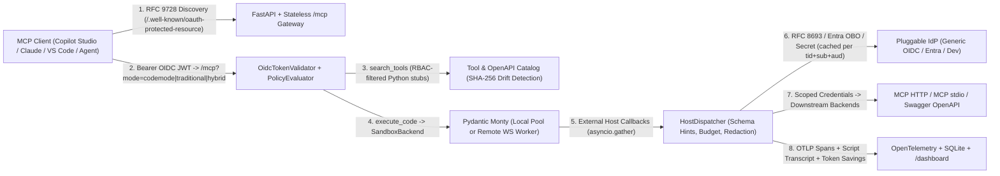

# MCPcodeaway — Vendor-Agnostic Code-Mode Universal MCP Gateway

`MCPcodeaway` is a stateless, vendor-agnostic **Universal MCP Gateway** built with **FastAPI**, the official **MCP SDK**, and **Pydantic Monty**. It combines enterprise API governance (OIDC/OAuth 2.1 validation, team/agent RBAC, RFC 8693 / Entra On-Behalf-Of delegation, input schema validation, PII/secret redaction, OpenTelemetry audit logging) with **Code Mode** progressive tool discovery and sandboxed Python orchestration.

---

## Architecture



### Decoupled Execution × Discovery Matrix (`2 × 2`)

Execution style and tool discovery are orthogonal axes controlled via `?execution=classic|codemode|hybrid&discovery_mode=upfront|deferred|x_intent` (headers `X-Execution-Mode` / `X-Discovery-Mode`) or legacy `?mode=` aliases:

| Mode / Axes | `tools/list` Surface | Best For |
| :--- | :--- | :--- |
| **`traditional`** (`classic` × `upfront`) | All authorized JSON tool schemas | Small catalogs (`<15` tools), simple lookups |
| **`traditional_discover`** (`classic` × `deferred`) | `list_servers`, `search_tools` (hydrates JSON schemas on demand) | Large catalogs with small/fast LLMs (`4B–9B`) & moderate payloads |
| **`codemode_upfront`** (`codemode` × `upfront`) | `execute_code` only (with authorized Python stubs inlined) | Compact/medium catalogs needing 1-shot batched joins without discovery hops |
| **`codemode`** (`codemode` × `deferred`, default) | `list_servers`, `search_tools`, `execute_code` | Massive catalogs (50–500+ tools) + multi-system filtering in Monty |
| **`hybrid`** (`hybrid` × `upfront\|deferred`) | `execute_code` + direct mutating MCP tools | Batched read joins in Monty + human-confirmed direct writes |

> **Why Gateway-Side Monty vs. Local Client-Side Execution?** Client-side code mode only works inside local coding agents (Cursor, Claude Code), leaks upstream round-trips & raw payloads over the WAN, and requires exposing tokens or client SDKs. Gateway-side Monty keeps OIDC/OBO tokens locked inside `HostDispatcher` inside your VPC, works with any MCP client (Copilot Studio, Claude Desktop, web apps), filters hundreds of raw rows before returning to LLM context, and records a single tamper-evident audit transcript (`_provenance` HMAC + `require_tool_grounding` policy).

---

## Quickstart (Zero External Dependencies)

```bash
# 1. Install dependencies (Python 3.13 + uv)
uv sync --extra dev

# 2. Start mock enterprise backends (Snowflake MCP, EU/US Billing OpenAPI, Ops Ticketing MCP)
uv run uvicorn examples.mock_backends:app --port 8001

# 3. Start the gateway in another terminal
uv run uvicorn gateway.server:app --port 8000 --reload
```

Open **`http://127.0.0.1:8000/dashboard`** for:
- **Overview & Benchmarks**: Catalog scaling charts and audit telemetry.
- **Add MCP / Swagger Wizard**: Plug in any `mcp_http`, `mcp_stdio`, or Swagger/OpenAPI spec (`URL` or pasted JSON), inspect tools & risk flags, export `upstreams.yaml` for PR promotion, and review the **Classic MCP vs. Code Mode Onboarding Audit**.
- **Side-by-Side Playground**: Replay workloads on Classic MCP vs. Code Mode across personas.
- **OIDC Delegation & RBAC Simulator**: Mint dev tokens and inspect RBAC-filtered tool access.
- **Code Mode Transcripts**: Inspect executed Python scripts, Monty sub-calls, delegated token hops, and payload byte reduction.

### CLI Onboarding

```bash
# Inspect an OpenAPI/Swagger spec and export a PR-ready upstreams.yaml snippet
uv run gateway add-mcp \
  --name billing_eu \
  --type openapi \
  --url http://127.0.0.1:8001/billing-eu \
  --openapi-spec-url http://127.0.0.1:8001/billing-eu/openapi.json \
  --export-yaml

# Run Classic vs. Code Mode side-by-side comparison
uv run gateway compare --scenario reconcile_overdue --persona finance_analyst
```

---

## Proof of Performance (Measured Results)

Reproduce locally with zero API keys:

```bash
uv run python benchmarks/run_benchmark.py
uv run python benchmarks/load_benchmark.py --users 30 --concurrency 15
```

### 1. Catalog Scaling (`tools/list` Schema Bloat vs. Code Mode)

| Catalog Size | Classic MCP Tokens | Code Mode Surface Tokens | Reduction |
| ---: | ---: | ---: | ---: |
| 20 tools | 2,030 | 265 | **86.95%** |
| 50 tools | 5,073 | 265 | **94.78%** |
| 150 tools | 15,218 | 265 | **98.26%** |
| 300 tools | 30,436 | 265 | **99.13%** |
| 500 tools | 50,726 | 265 | **99.48%** |

### 2. Enterprise Workloads (4-Backend Finance & Ops Catalog)

| Scenario | Classic Tokens | Code Mode Tokens | Savings | Round Trips | Winner |
| :--- | ---: | ---: | ---: | :---: | :--- |
| `reconcile_overdue` (Snowflake + EU/US Billing join) | 2,556 | 1,146 | **55.16%** | `4 -> 2` | `code_mode` |
| `trial_balance_audit` (Variances + contact lookup) | 2,560 | 1,184 | **53.75%** | `5 -> 2` | `code_mode` |
| `single_lookup` (Control: 1 balance read) | 985 | 1,154 | -17.16% | `2 -> 2` | `classic_or_tie` |

### 3. Concurrent Multi-User Load (30 Requests, 10 Users, Concurrency 15)

| Mode | Throughput | Success Rate | Delegated Token Cache Hit Rate |
| :--- | ---: | ---: | ---: |
| `traditional` | 27.10 req/s | 100.0% | 66.67% |
| `codemode` | 26.63 req/s | 100.0% | 66.67% |

*(Optional live LLM evaluation with OpenAI, Anthropic, or Gemini is available via `uv run python benchmarks/live_llm_bench.py --dry-run` or by setting `OPENAI_API_KEY` / `ANTHROPIC_API_KEY` / `GEMINI_API_KEY`.)*

---

## Vendor-Agnostic Integrations & Scaling

- **AuthN / AuthZ Presets**: Core relies exclusively on OIDC JWKS + RFC 8693 / RFC 9728 standards. Ready-to-use configurations live in:
  - [Entra ID + Copilot Studio Preset](examples/integrations/entra_copilot_studio/README.md)
  - [Keycloak / Okta / Generic OIDC Preset](examples/integrations/keycloak_oidc/gateway.env.example)
  - [Claude / VS Code / Cursor MCP Client Configs](examples/integrations/mcp_clients/clients.json)
- **Horizontal Scaling**: Run `docker compose --profile scaled up` for multi-replica stateless gateways, shared Redis token/rate-limit caching, and egress-isolated `sandbox-worker` pods over WebSocket reverse-RPC. See [Cloud & Sandbox Scalability Guide](docs/cloud_scalability.md).

## Verification

```bash
uv run ruff check src examples benchmarks tests
uv run pytest -v
```
