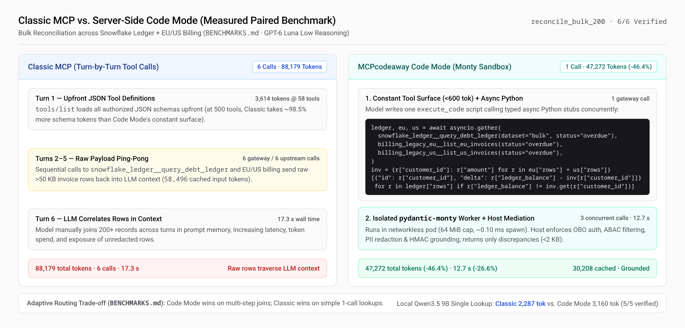
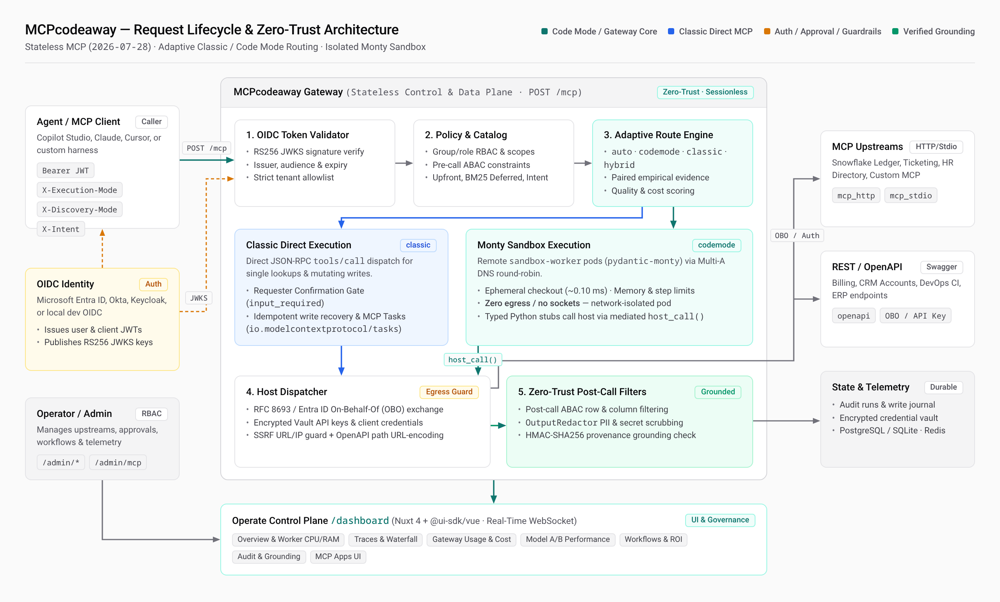
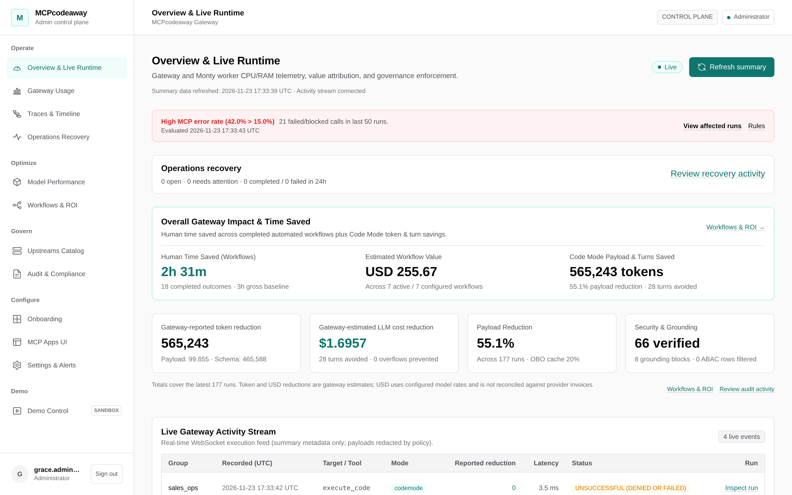
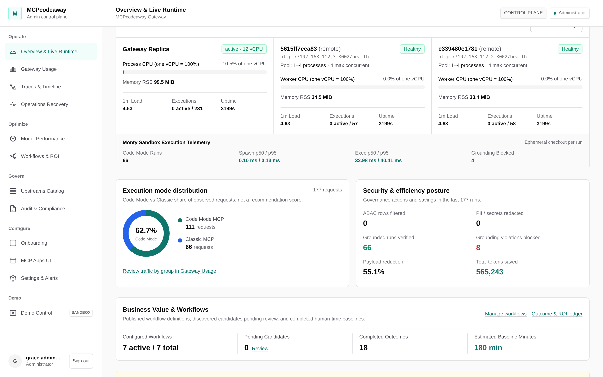
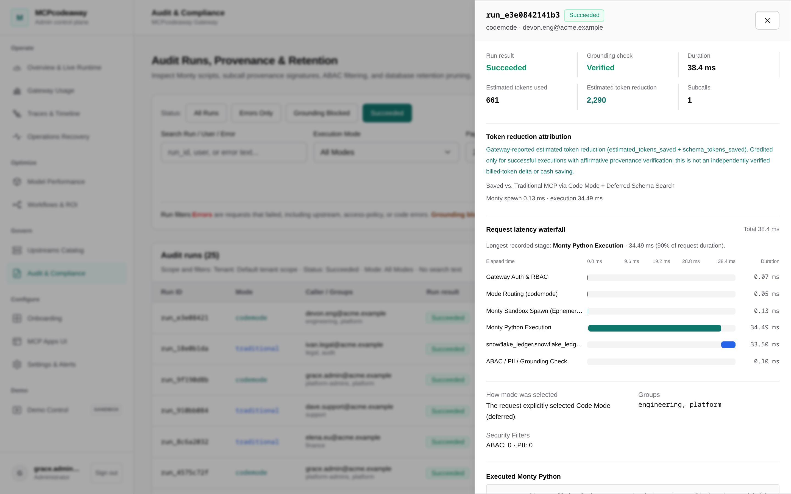
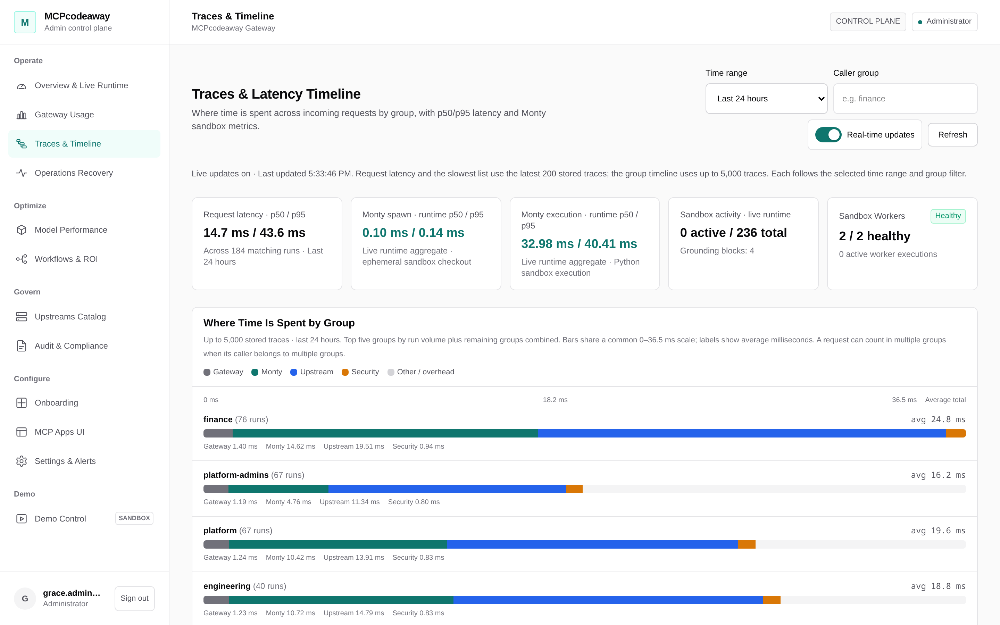
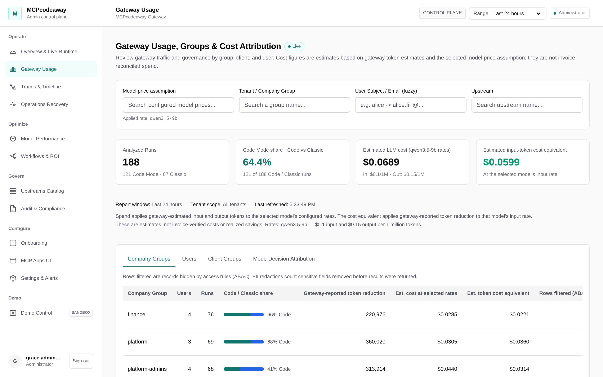
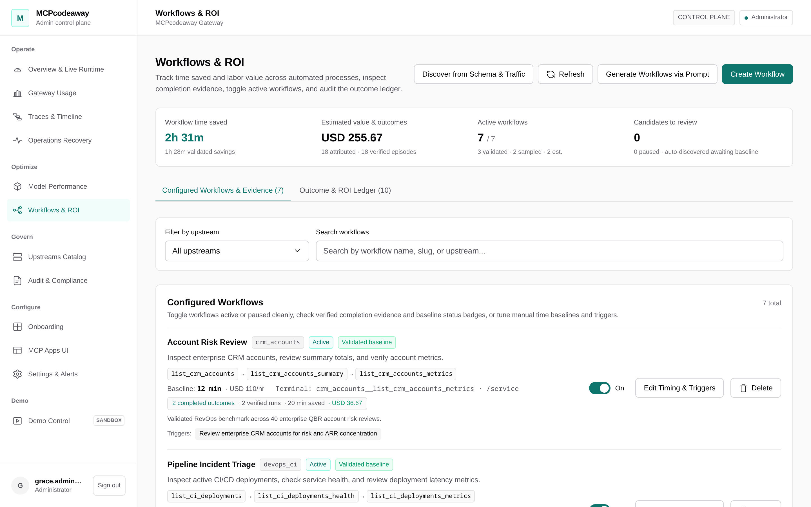
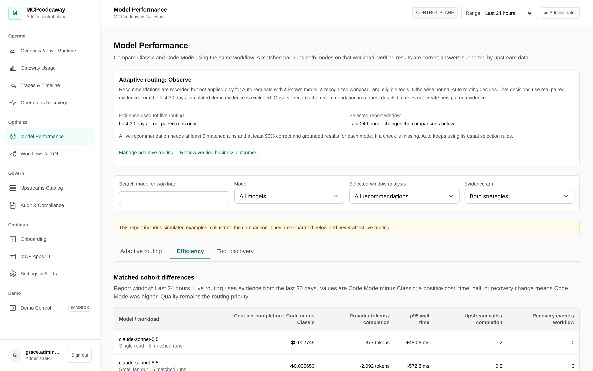
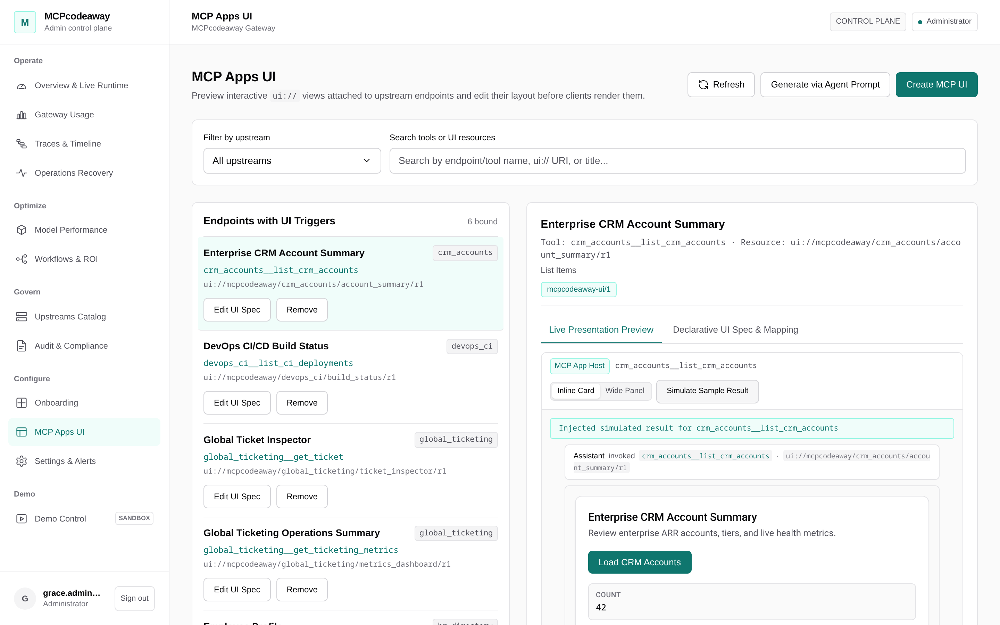

# MCPcodeaway

<p align="center">
  <strong>Universal Enterprise Model Context Protocol (MCP) Gateway with Code Mode, Adaptive Routing, and Zero-Trust Governance.</strong>
</p>

<p align="center">
  <a href="https://github.com/Joel-Duarte/MCPcodeaway/actions/workflows/backend-ci.yml"></a>
  <a href="https://github.com/Joel-Duarte/MCPcodeaway/actions/workflows/frontend-ci.yml"></a>
  <a href="https://github.com/Joel-Duarte/MCPcodeaway/actions/workflows/qa-ci.yml"></a>
  <a href="https://github.com/Joel-Duarte/MCPcodeaway/actions/workflows/security-ci.yml"></a>
</p>

<p align="center">
  <a href="#quickstart"></a>
  <a href="BENCHMARKS.md"></a>
  
  
  
  <a href="LICENSE"></a>
</p>

---

## Overview

**MCPcodeaway** bridges enterprise Identity Providers (Microsoft Entra ID, Okta, Keycloak, or local dev OIDC) to heterogeneous upstream services (`mcp_http`, `mcp_stdio`, and OpenAPI / Swagger REST APIs).

Traditional MCP exposes dozens of individual tool schemas directly into the LLM context window. For multi-step workflows, this forces the LLM to make turn-by-turn round trips, blowing through token budgets, driving up latency, and leaking raw sensitive payloads across the network.

MCPcodeaway solves this with **server-side Code Mode**:
1. It injects typed Python stubs into an ephemeral, networkless **Monty (`pydantic-monty`)** sandbox.
2. The model writes a Python script that joins, filters, and aggregates data server-side in a single execution turn.
3. Callbacks to upstream tools remain strictly mediated and authorized by the host gateway.
4. The client receives a clean, grounded summary — cutting reported tokens by **46.4%** (`47,272` vs. `88,179`), wall time by **26.6%** (`12.7s` vs. `17.3s`), and gateway round-trips from `6` to `1` in our [Bulk Reconciliation paired test](BENCHMARKS.md#paired-pilot-results), while Adaptive Routing keeps simple single-call lookups on Classic MCP.

<p align="center">
  
</p>

---

## Architecture

<p align="center">
  
</p>

Every request on `POST /mcp` is stateless and passes through five enforced stages before reaching an upstream service or returning data to the caller:

1. **OIDC & Policy Boundary:** `OidcTokenValidator` verifies RS256 JWKS signatures and tenant allowlists; `PolicyEvaluator` enforces role/group RBAC and pre-call ABAC argument constraints.
2. **Adaptive Route Engine:** Resolves `auto`, `codemode`, `classic`, or `hybrid` execution alongside `upfront`, `deferred` (BM25), or `intent` (`X-Intent`) tool discovery.
3. **Dual Execution Lanes:** Single lookups and gated writes (`input_required`) run via Classic JSON-RPC; multi-step workflows run inside networkless remote `sandbox-worker` pods (`pydantic-monty`) with typed Python stubs.
4. **Host Dispatcher & Post-Call Governance:** Upstream `host_call()` requests pass RFC 8693 / Entra ID OBO token exchange and SSRF guards, then responses undergo post-call ABAC row filtering, PII/secret redaction (`OutputRedactor`), and HMAC-SHA256 provenance grounding checks.

<details>
<summary>Text-only ASCII architecture diagram</summary>

```
                  Client / Agent Harness (Copilot Studio, Claude, Cursor)
                                            │
                             Bearer JWT + MCP JSON-RPC
                                            ▼
┌────────────────────────────────────────────────────────────────────────────────────────┐
│                                 MCPcodeaway Gateway                                    │
│                                                                                        │
│  ┌───────────────────────┐  ┌────────────────────────┐  ┌───────────────────────────┐  │
│  │ OIDC Token Validator  │  │   Policy Evaluator     │  │   Adaptive Route Engine   │  │
│  │  • RS256 JWKS Verify  │  │    • Tenant Isolation  │  │    • Classic vs Code Mode │  │
│  │  • Tenant Allowlist   │  │    • Role/Group RBAC   │  │    • Upfront vs Deferred  │  │
│  └───────────────────────┘  └────────────────────────┘  └───────────────────────────┘  │
│                                           │                                            │
│                ┌──────────────────────────┴──────────────────────────┐                 │
│                ▼                                                     ▼                 │
│     [ Classic Direct Call ]                                 [ Code Mode Execution ]    │
│                │                                                     │                 │
│                │                                       ┌─────────────┴──────────────┐  │
│                │                                       │ Monty Sandbox Backend      │  │
│                │                                       │ (Local Rust or Remote Pod) │  │
│                │                                       │ • Zero Egress / No Sockets │  │
│                │                                       │ • Memory & Step Limits     │  │
│                │                                       └─────────────┬──────────────┘  │
│                │                                                     │ host_call()     │
│                ▼                                                     ▼                 │
│  ┌──────────────────────────────────────────────────────────────────────────────────┐  │
│  │                               Host Dispatcher                                    │  │
│  │   • RFC 8693 / Entra OBO Token Exchange    • SSRF URL & Port Validation          │  │
│  │   • Pre- & Post-Call ABAC Row Filtering    • HMAC-SHA256 Tool Provenance Sign    │  │
│  │   • PII / Secret Data Redaction            • Sensitive Write Deduplication       │  │
│  └──────────────────────────────────────┬───────────────────────────────────────────┘  │
└─────────────────────────────────────────┼──────────────────────────────────────────────┘
                                          │
                   ┌──────────────────────┴──────────────────────┐
                   ▼                                             ▼
       ┌────────────────────────┐                    ┌────────────────────────┐
       │   MCP HTTP / Stdio     │                    │  OpenAPI / REST APIs   │
       │ (Snowflake, Jira, CRM) │                    │ (Billing, ERP, Custom) │
       └────────────────────────┘                    └────────────────────────┘
```

</details>

---

## Key Features

- **Adaptive Execution Routing:** Empirically measures token consumption, latency, and correctness between Classic MCP and Code Mode per model and workload, automatically selecting the optimal route.
- **Dynamic Tool Discovery:** Choose between upfront schema listings, intent-based pre-filtering (`X-Intent`), or deferred BM25 search across catalogs with 10,000+ tools.
- **Zero-Trust Enterprise Security:**
  - RS256 JWT validation with strict tenant allowlisting.
  - RFC 8693 & Microsoft Entra ID On-Behalf-Of (OBO) delegated token exchange.
  - Host-side Attribute-Based Access Control (ABAC) row and column filtering.
  - Cryptographic HMAC provenance signing that rejects ungrounded or hallucinated identifiers.
  - SSRF URL guards blocking cloud metadata and private network addresses.
- **Requester Confirmation Gates:** Sensitive mutating tools pause execution and elicit caller confirmation via native MCP `input_required` protocol messages before dispatching upstream.
- **Stateless & Sessionless MCP (`2026-07-28`):** Adheres strictly to the modern sessionless MCP specification. Requests are self-contained and independently authorized across load-balanced replicas.
- **Operate Control Plane (`/dashboard`):** Fully responsive Nuxt 4 + `@ui-sdk/vue` web console with real-time WebSocket telemetry, multi-worker Monty sandbox health cards, unified `Workflows & ROI` governance (`/workflows`), gateway reporting currency & regional labor rate configuration (`/settings`), request traces (`/traces`), usage analytics (`/analytics`), model A/B testing (`/model-performance`), and in-page workflow/prompt drawers across upstreams and MCP Apps (`/upstreams`, `/mcp-ui`).

---

## Operate Control Plane (`/dashboard`)

Embedded **Nuxt 4** admin console captured live against the running demo stack (`docker compose up --build`). Click any thumbnail to open the full-resolution view.

| Runtime, Telemetry & Traces | Execution, Governance & Apps |
| :---: | :---: |
| <a href="docs/images/ui-overview-runtime.png"></a><br><sub>**Overview & Live Runtime** — Token/time savings, alert rules & live WebSocket feed</sub> | <a href="docs/images/ui-compute-telemetry.png"></a><br><sub>**Multi-Worker Telemetry** — Gateway replica, remote `sandbox-worker` pods & mode split</sub> |
| <a href="docs/images/ui-audit-waterfall.png"></a><br><sub>**Audit & Latency Waterfall** — Per-stage ms breakdown, Monty spawn (`0.13 ms`) & HMAC grounding</sub> | <a href="docs/images/ui-traces-timeline.png"></a><br><sub>**Traces & Latency Timeline** — `p50/p95` sandbox timing & time spent by caller group</sub> |
| <a href="docs/images/ui-gateway-usage.png"></a><br><sub>**Gateway Usage & Cost** — Per-group Code Mode share, token reduction & spend estimates</sub> | <a href="docs/images/ui-workflows-roi.png"></a><br><sub>**Workflows & ROI** — Validated time baselines, tool chains & regional labor value</sub> |
| <a href="docs/images/ui-model-performance.png"></a><br><sub>**Model Performance** — Paired Classic vs. Code Mode deltas powering Adaptive Routing</sub> | <a href="docs/images/ui-mcp-apps.png"></a><br><sub>**Interactive MCP Apps (`ui://`)** — Declarative UI views & live simulated host preview</sub> |

---

## Execution × Discovery Matrix

Callers can configure execution and discovery strategies independently via query parameters (`?execution=...&discovery_mode=...`) or HTTP headers (`X-Execution-Mode`, `X-Discovery-Mode`, `X-Intent`):

| Execution Mode | Upfront Discovery | Deferred Discovery | Intent-Filtered (`X-Intent`) |
| :--- | :--- | :--- | :--- |
| **`classic`** | Full tool listing upfront; direct JSON-RPC tool calls. | `discover_tools` meta-tool + direct JSON-RPC tool calls. | Pre-filtered direct tool schemas matching intent. |
| **`codemode`** | Upfront Python stubs in `execute_code` catalog. | `discover_tools` + minimal `execute_code` (~460 tokens). | Intent-matched Python stubs injected into sandbox. |
| **`hybrid`** | Upfront stubs; exposes both direct calls and `execute_code`. | Deferred discovery; both execution paths available. | Intent pre-filtered hybrid execution surface. |
| **`auto`** | Dynamically routes based on matched empirical benchmark evidence and configured quality/cost thresholds. |

---

## Quickstart

### Option A: Docker Compose (Recommended)

Run the full demo stack (gateway, isolated `sandbox-worker` replicas, mock enterprise backends, and pre-built Nuxt 4 control plane) in one command:

```bash
git clone https://github.com/Joel-Duarte/MCPcodeaway.git
cd MCPcodeaway
docker compose up --build
```

### Option B: Local Development (`uv` + Node.js 22+)

Get up and running locally with Python 3.12+, [`uv`](https://docs.astral.sh/uv/), and Node.js 22+:

```bash
# 1. Clone and install backend + frontend dependencies
git clone https://github.com/Joel-Duarte/MCPcodeaway.git
cd MCPcodeaway
uv sync --extra dev --extra postgres
(cd web && npm ci && npm run generate)

# 2. Start mock enterprise backends (Snowflake MCP, Billing OpenAPI, Ticketing MCP)
uv run uvicorn examples.mock_backends:app --port 8001 &

# 3. Start the MCPcodeaway gateway in demo profile
GATEWAY_PROFILE=demo uv run uvicorn gateway.server:app --port 8000
```

Open **`http://127.0.0.1:8000/dashboard`** in your browser to access the control plane, inspect registered upstreams, and test live tool executions.

You can also use the `gateway` CLI to inspect/onboard upstreams or run Classic vs. Code Mode comparisons:

```bash
uv run gateway compare --scenario reconcile_overdue
```

---

## Configuration Example

Register upstreams in `config/upstreams.yaml`:

```yaml
upstreams:
  # MCP HTTP Server with Delegated OBO Token Exchange
  - name: snowflake_ledger
    type: mcp_http
    url: https://snowflake.internal.company.com/mcp
    auth_type: delegated_token
    downstream_audience: api://snowflake-mcp
    allowed_groups: ["finance", "auditors"]
    allowed_roles: ["finance_analyst"]
    tool_effects:
      query_debt_ledger: read
      reconcile_accounts: read

  # OpenAPI / Swagger REST Service with Requester Confirmation Gate
  - name: billing_service
    type: openapi
    url: https://billing.internal.company.com/api
    openapi_spec_url: https://billing.internal.company.com/api/openapi.json
    auth_type: api_key
    secret_env_var: BILLING_API_KEY
    allowed_roles: ["billing_admin"]
    allowed_operations: ["get_invoice", "issue_refund"]
    tool_effects:
      get_invoice: read
      issue_refund: write
    mutating_tools: ["issue_refund"]
    tool_approval_policies:
      issue_refund:
        mode: requester_confirmation
        version: 1
        confirmation_message: "Confirm issuing refund for invoice {invoice_id}?"
```

---

## Benchmarks & Efficiency

All figures below come from **paired test runs** against deterministic mock Snowflake and EU/US billing services (not universal production averages across all workloads). On multi-step bulk joins, Code Mode eliminates repeated round-trips; on simple single-tool lookups or smaller models, Classic MCP can use fewer tokens — which is why Adaptive Routing evaluates each model × workload pair empirically:

| Model & Mock Workload | Classic MCP | Code Mode | Measured Outcome | Gateway Calls |
| :--- | ---: | ---: | :--- | :---: |
| **GPT-6 Luna (Low)** — Bulk Reconciliation (`reconcile_bulk_200`) | 88,179 tokens (17.3s) | **47,272 tokens (12.7s)** | **46.4% fewer tokens**, 26.6% faster | 1 vs 6 |
| **GPT-6 Luna (Low)** — Standard Reconciliation | **49,374 tokens** (17.3s) | 64,937 tokens (**11.1s**) | **35.8% faster** (`11.1s`), +31.5% tokens | 1 vs 3 |
| **Local Qwen3.5 9B** — Single Lookup | **2,287 tokens** (5/5 verified) | 3,160 tokens (5/5 verified) | **Classic uses 27.6% fewer tokens** | 1 vs 1 |

- **Schema-only catalog scaling ([`benchmarks/run_benchmark.py`](benchmarks/run_benchmark.py)):** Exposing a constant 3-tool Code Mode surface (`<600` tokens) cuts upfront tool-definition bloat by **98.5%+** at 500 synthetic tools compared to Classic `tools/list`.
- **Full details & methodology:** See [BENCHMARKS.md](BENCHMARKS.md) for cached-input accounting, 1.5B/4B/9B Qwen runs, BM25 discovery latency up to 10,010 tools, and Cloudflare portal comparisons, plus the **Model Performance** preview in the [Operate Control Plane](#operate-control-plane-dashboard) gallery above.

---

## Production Deployment

### Docker Multi-Stage Builds

The repository provides targeted multi-stage Docker builds:
- `gateway`: Barebones production runtime. Contains zero Node.js or development assets.
- `sandbox-worker`: Dedicated, egress-isolated Monty execution worker.
- `gateway-ui`: Production gateway with pre-compiled Nuxt 4 static dashboard.

```bash
# Run production multi-replica stack with Nginx, Redis, and PostgreSQL
docker compose --profile prod up -d
```

### Kubernetes

Deploy gateway pods as the stateless Control Plane and `sandbox-worker` pods inside an egress-isolated namespace governed by a deny-all `NetworkPolicy`. See [docs/kubernetes.md](docs/kubernetes.md) for manifests, architecture topology, and local `kind` cluster testing.

---

## Verification & Pre-CI Gates

Run the local verification suite:

```bash
# Fast gate: AST situational checks, agent preflight, ruff lint, golden flows
./scripts/pre-ci.sh --fast

# Full gate: complete test suite, Nuxt SPA generation, benchmark verification
./scripts/pre-ci.sh --full
```

---

## Documentation Index

| Guide | Description |
| :--- | :--- |
| [System Flows & Audit](docs/flows.md) | Master catalog and audit of all MCP, End-User, and Admin flows across routes, UI pages, and tests. |
| [Gateway Flow Map](docs/gateway-flow-map.md) | End-to-end request lifecycle, auth gates, and dispatch sequences. |
| [MCP Tasks & Write Recovery](docs/mcp-tasks.md) | Sessionless `io.modelcontextprotocol/tasks` lifecycle, durable leases, and legacy status fallback. |
| [Workflows, ROI & Multi-Worker Ops](docs/workflows-and-roi.md) | Unified Workflows & ROI control plane, gateway currency/regional rate overrides, and multi-worker Monty telemetry. |
| [Agent Onboarding & Golden Testing](docs/agent-onboarding-and-evaluation.md) | AI-agent integration bundle flow, prompt pack, and golden ticketing test suite. |
| [State Machines](docs/state-machines.md) | Lifecycle state transitions for gateway, approvals, and sessions. |
| [Cloud Scalability](docs/cloud_scalability.md) | Stateless scaling, remote Monty workers, and load balancing. |
| [Kubernetes Deployment](docs/kubernetes.md) | Multi-replica architecture, egress isolation, and kind local testing. |
| [Company SSO & OIDC](docs/oidc_deployment.md) | Setting up Entra ID, Okta, Keycloak, and control-plane RBAC. |
| [Auth Spectrum Flows](docs/auth_spectrum_flows.md) | Handling upstream auth variants (OBO, client credentials, API keys). |
| [PostgreSQL State Architecture](docs/postgres-state-architecture.md) | Durable write journals, database roles, migrations, and operational signals. |
| [Credential Lifecycle](docs/credential-lifecycle.md) | Encrypted secrets at rest, token scopes, and key rotation. |
| [Approval Gate Proposal](docs/approval-gate-enhancements.md) | Requester confirmation design, protocol elicitation, and safety boundaries. |
| [Local Integration Testing](docs/local-integration-testing.md) | Running local integration and disposable PostgreSQL acceptance suites. |
| [Architecture Decision Records](docs/adr/) | 14 architectural decisions documenting core gateway invariants. |

---

## Contributing, Security & License

- **Contributing:** See [CONTRIBUTING.md](CONTRIBUTING.md) for local setup, coding standards, and pre-CI verification, and adhere to our [Code of Conduct](CODE_OF_CONDUCT.md).
- **Security:** Please report vulnerabilities privately via [GitHub Security Advisories](https://github.com/Joel-Duarte/MCPcodeaway/security/advisories/new) as described in [SECURITY.md](SECURITY.md).
- **License:** Released under the [MIT License](LICENSE).
