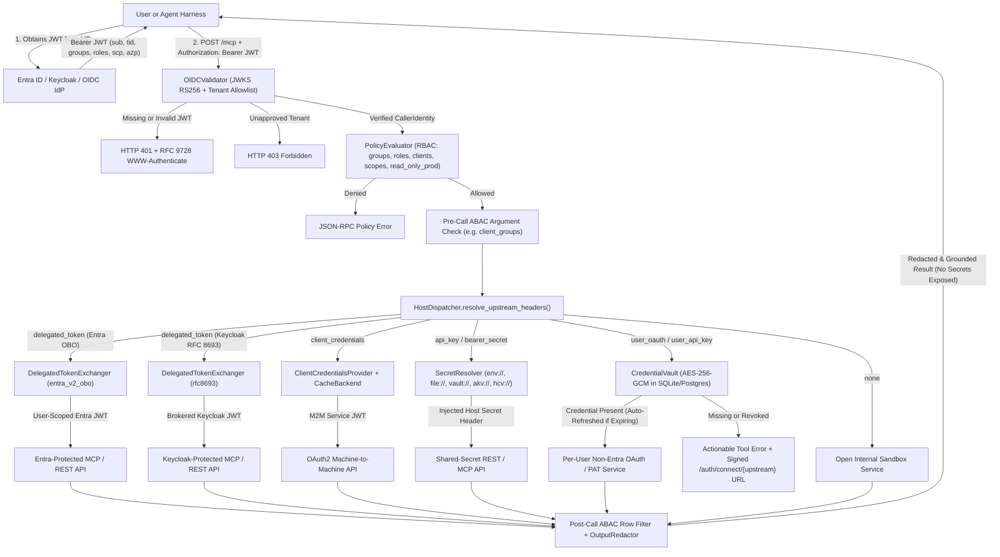
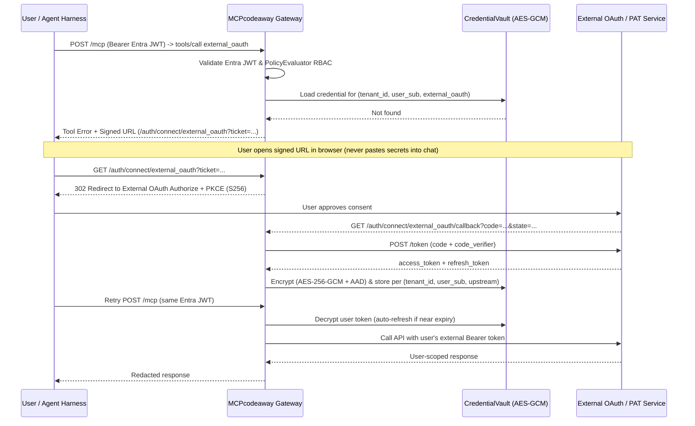

# Authentication & Authorization Spectrum Flows

This document illustrates how **MCPcodeaway** bridges a single caller identity (Microsoft Entra ID, Keycloak, or a headless OAuth client) across every downstream authentication and authorization variation—both when the downstream service trusts Entra and when it does not.

---

## 1. Full Authentication & Authorization Spectrum Flow Board

---

## 2. Non-Entra Per-User Credential Linking (`user_oauth` / `user_api_key`)

When a downstream service does **not** use Entra ID and requires each user's own OAuth consent or Personal Access Token (PAT), Entra never holds those credentials. Instead, the gateway uses an encrypted per-user `CredentialVault`:

---

## 3. Spectrum Reference Matrix

| Scenario | `auth_type` | How Identity Flows | Where Verified |
| :--- | :--- | :--- | :--- |
| **Downstream uses Entra ID** | `delegated_token` (`entra_v2_obo`) | Entra JWT exchanged on-behalf-of user for downstream Entra audience | [`test_auth_spectrum_golden.py`](../tests/test_auth_spectrum_golden.py) (`inventory_obo`) |
| **Downstream uses Keycloak (Entra brokered)** | `delegated_token` (`rfc8693`) | Entra or Keycloak JWT exchanged via RFC 8693 against Keycloak token endpoint | [`test_auth_spectrum_golden.py`](../tests/test_auth_spectrum_golden.py) (`tax_keycloak`) |
| **Downstream uses OAuth M2M** | `client_credentials` | Gateway enforces caller RBAC, then fetches cached M2M token | [`test_auth_spectrum_golden.py`](../tests/test_auth_spectrum_golden.py) (`metrics_m2m`) |
| **Downstream uses shared API key / Bearer** | `api_key` / `bearer_secret` | Gateway enforces caller RBAC, resolves `vault://` / `file://` / `env://` / `akv://` / `hcv://` | [`test_auth_spectrum_golden.py`](../tests/test_auth_spectrum_golden.py) (`inventory_apikey`, `tax_bearer`) |
| **Downstream uses per-user OAuth (non-Entra)** | `user_oauth` | User links once via PKCE `/auth/connect/{upstream}`; gateway auto-refreshes | [`test_auth_spectrum_golden.py`](../tests/test_auth_spectrum_golden.py) (`external_oauth`) |
| **Downstream uses per-user PAT** | `user_api_key` | User saves PAT in `/auth/connect/{upstream}` or `/connections` UI; isolated per `(tenant, sub)` | [`test_auth_spectrum_golden.py`](../tests/test_auth_spectrum_golden.py) (`external_pat`) |
| **Open internal sandbox** | `none` | No downstream creds; gated strictly by gateway OIDC + RBAC | [`test_auth_spectrum_golden.py`](../tests/test_auth_spectrum_golden.py) (`sandbox_open`) |
