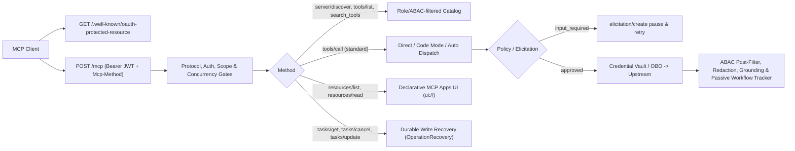

# System Flows Catalog & Audit

Master index of every **MCP Caller**, **End-User Self-Service**, and **Admin / Operator** flow implemented in MCPcodeaway, paired with a codebase audit comparing implemented handlers against documentation and automated tests.

> For deep sequence diagrams of the core proxy pipeline, see [Gateway Flow Map](gateway-flow-map.md). For state transitions, see [State Machines](state-machines.md).

## 1. MCP Caller Flows (`POST /mcp` & `/.well-known/*`)

All runtime agent/client requests enter stateless `POST /mcp` (`MCP-Protocol-Version: 2026-07-28`) with per-request JWT verification and fail-closed authorization.

| Flow | Entrypoint & Headers / Params | Key Behavior & Guards | Primary Source & Tests |
| :--- | :--- | :--- | :--- |
| **OAuth Metadata Discovery** | `GET /.well-known/oauth-protected-resource`, `GET /.well-known/oauth-authorization-server` | Advertises gateway issuer, audience, and scopes before token acquisition. | [`oauth_discovery.py`](../src/gateway/oauth_discovery.py); [`test_auth_obo.py`](../tests/test_auth_obo.py) |
| **Server & Tool Discovery** | `POST /mcp`: `server/discover`, `tools/list`, `tools/call` (`search_tools`, `list_servers`) | Advertises `extensions` (`io.modelcontextprotocol/tasks`, optional MCP Apps mime type); filters tools by identity RBAC/scopes and deferred/intent query. | [`server.py`](../src/gateway/server.py), [`catalog.py`](../src/gateway/catalog.py); [`test_discovery_system1.py`](../tests/test_discovery_system1.py) |
| **Direct & Code Mode Execution** | `POST /mcp?mode=traditional\|codemode\|hybrid\|auto`, `execution=auto` (`X-Intent`) | Routes via `evaluate_mode_algorithm()`, executes direct upstream HTTP/MCP/stdio calls or Monty sandbox (`execute_code`), applies upstream read retry (`1x`), circuit breaker, and OBO/vault credentials. | [`dispatcher.py`](../src/gateway/dispatcher.py), [`sandbox.py`](../src/gateway/sandbox.py); [`test_golden_flows.py`](../tests/test_golden_flows.py) |
| **Grounding, ABAC & Redaction** | Code Mode `require_grounding=true`; all responses | Rejects unverified fabricated entity IDs (`UnverifiedEntityError`), filters rows by caller region/group (`EU` vs `US`), and masks PII via `OutputRedactor`. | [`dispatcher.py`](../src/gateway/dispatcher.py); [`test_provenance_and_axes.py`](../tests/test_provenance_and_axes.py), [`test_golden_flows.py`](../tests/test_golden_flows.py) |
| **Requester Confirmation & Manager Approval** | `tools/call` + client `elicitation.form` capability | Returns `resultType: "input_required"` (`elicitation/create`) with canonical argument digest/policy version binding; optionally escalates to `/admin/approvals/{id}/decision`. | [`server.py`](../src/gateway/server.py), [Approval Enhancements](approval-gate-enhancements.md); [`test_approval_golden.py`](../tests/test_approval_golden.py) |
| **MCP Tasks & Legacy Fallback** | `tools/call` (with `io.modelcontextprotocol/tasks` ext), `tasks/get`, `tasks/cancel`, `tasks/update`, `get_operation_status` | Idempotent writes exceeding sync budget enqueue encrypted leased tasks across replicas with optional `status_tool` reconciliation. | [MCP Tasks Guide](mcp-tasks.md), [`recovery.py`](../src/gateway/recovery.py); [`test_mcp_task_recovery.py`](../tests/test_mcp_task_recovery.py) |
| **MCP Apps UI Delivery** | `resources/list`, `resources/read` (`ui://mcpcodeaway/...`) + `ui` client capability | Attaches `_meta.ui.resourceUri` to tools and renders declarative `text/html;profile=mcp-app` views on `resources/read`. | [`mcp_app_renderer.py`](../src/gateway/mcp_app_renderer.py); [`test_mcp_app_renderer.py`](../tests/test_mcp_app_renderer.py) |
| **Passive Workflow & Regional ROI Tracking** | Every tool & Code Mode callback dispatch | Correlates multi-step episodes via `WorkflowEpisodeTracker`, verifies readback predicates, skips paused (`enabled: false`) definitions, and applies `regional_labor_rates` from JWT claims. | [`workflow_detector.py`](../src/gateway/workflow_detector.py), [`workflows-and-roi.md`](workflows-and-roi.md); [`test_workflow_detector.py`](../tests/test_workflow_detector.py) |

## 2. End-User Self-Service & Caller Audit Flows

| Flow | Route(s) | Key Behavior & Guards | Source & Tests |
| :--- | :--- | :--- | :--- |
| **Caller Identity Check** | `GET /auth/me` | Validates bearer JWT and returns mapped `tenant_id`, `sub`, `roles`, `groups`, and `scopes`. | [`oauth_discovery.py`](../src/gateway/oauth_discovery.py); [`test_auth_obo.py`](../tests/test_auth_obo.py) |
| **Per-User Downstream OAuth Linking** | `GET /auth/connect/{upstream_name}`, `GET /auth/connect/{upstream_name}/callback` | Launches PKCE OAuth linking for non-Entra `user_oauth` upstreams via signed tickets and stores encrypted personal tokens. | [`user_connect.py`](../src/gateway/user_connect.py), [Auth Spectrum Flows](auth_spectrum_flows.md); [`test_user_connect.py`](../tests/test_user_connect.py) |
| **Per-User API Key Management** | `POST /auth/connect/{upstream_name}/secret`, `GET /me/connections`, `POST /me/connections/{upstream_name}/secret`, `DELETE /me/connections/{upstream_name}` | Lets callers store, rotate, list, and delete personal downstream credentials without exposing ciphertexts. | [`user_connect.py`](../src/gateway/user_connect.py); [`test_user_connect.py`](../tests/test_user_connect.py) |
| **Caller-Scoped Audit & Value** | `GET /audit/runs`, `GET /audit/runs/{run_id}`, `GET /audit/summary`, `GET /audit/value`, `GET /audit/analytics` | Enforces tenant isolation (`_resolve_audit_tenant_scope()`); returns redacted execution traces, latency, and token compression savings. | [`server.py`](../src/gateway/server.py); [`test_security_hardening.py`](../tests/test_security_hardening.py) |
| **Local Development Token Minting** | `GET /dev/oidc/jwks`, `POST /dev/auth/token` | Active only in non-production development profiles to mint persona JWTs for local/golden runs. | [`oauth_discovery.py`](../src/gateway/oauth_discovery.py); [`test_mock_oidc_provider.py`](../tests/test_mock_oidc_provider.py) |

## 3. Admin & Operator Control Plane Flows

Protected by `_authorize_control_plane()` (`gateway_admin` for mutations; `operator_viewer` read-only access where `allow_viewer=True`). Disabled automatically when `profile=production`.

| Flow | Backend Routes | Console Page (`web/app/pages/`) | Key Capabilities & Tests |
| :--- | :--- | :--- | :--- |
| **Admin Auth & SSO Session** | `GET /auth/admin/config`, `/login`, `/callback`, `/session`; `POST /token-login`, `/dev-login`, `/logout` | [`login.vue`](../web/app/pages/login.vue) | OIDC PKCE + optional dev/bearer token login issuing signed `mcpcodeaway_admin_session` cookies. [`admin_auth.py`](../src/gateway/admin_auth.py); [`test_oidc_golden_flows.py`](../tests/test_oidc_golden_flows.py) |
| **Live Runtime & Multi-Worker Overview** | `WS /admin/ws/telemetry`, `GET /admin/telemetry/runtime` | [`index.vue`](../web/app/pages/index.vue) (`/dashboard`), [`traces.vue`](../web/app/pages/traces.vue) | Streams live execution events, `Overall Gateway Impact & Time Saved`, and concurrent health/pool stats for scaled `sandbox_workers`. [`runtime_stats.py`](../src/gateway/runtime_stats.py); [`overview-multiworker.spec.ts`](../web/tests/overview-multiworker.spec.ts) |
| **Upstream Catalog, Policy & Secrets** | `GET/POST/DELETE /admin/upstreams*`, `POST /inspect`, `/test-call`, `/catalog/refresh`, `PUT .../guidance`, `PUT .../approval-policy`, `/admin/secrets*` | [`upstreams.vue`](../web/app/pages/upstreams.vue), [`settings.vue`](../web/app/pages/settings.vue) | SSRF-validated OpenAPI/MCP/stdio inspection, live test calls, tool approval/recovery policies, and Redis catalog epoch sync. [`server.py`](../src/gateway/server.py); [`test_upstream_onboarding.py`](../tests/test_upstream_onboarding.py) |
| **Prompt-Pack Agent Onboarding & MCP UI Builder** | `GET /admin/onboarding/prompt-pack`, `POST .../bundle/validate`, `POST .../bundle/apply`, `GET/POST/PUT/DELETE /admin/mcp-ui/*` | [`onboarding.vue`](../web/app/pages/onboarding.vue), [`mcp-ui.vue`](../web/app/pages/mcp-ui.vue), [`PromptBundleDrawer.vue`](../web/app/components/PromptBundleDrawer.vue) | Copies upstream schemas + instructions to an AI agent, validates/applies workflows and declarative UIs, previews/simulates widgets, or creates custom tool UIs in-page. [`test_golden_agent_onboarding.py`](../tests/test_golden_agent_onboarding.py), [`workflows-and-mcp-ui.spec.ts`](../web/tests/workflows-and-mcp-ui.spec.ts) |
| **Workflow Governance, Candidate Promotion & ROI** | `GET/POST /admin/integration-definitions/*`, `GET /admin/workflows/*`, `POST .../promote\|dismiss`, `GET /admin/business-value/report`, `GET/PUT /admin/business-value/settings` | [`workflows.vue`](../web/app/pages/workflows.vue) ([`business-value.vue`](../web/app/pages/business-value.vue) redirects) | Unifies candidate promotion, active/pause switch, validated/sampled/unvalidated baselines, gateway currency, and per-country/region `regional_labor_rates`. [`workflows-and-roi.md`](workflows-and-roi.md); [`test_validation_governance.py`](../tests/test_validation_governance.py) |
| **Operations Write Recovery Inbox** | `GET /admin/operations`, `GET /admin/operations/metrics` | [`operations.vue`](../web/app/pages/operations.vue) | Read-only tenant-scoped inspection of `pending`, `working`, `needs_attention`, and upstream circuit health. [`test_operations_acceptance.py`](../tests/test_operations_acceptance.py) |
| **Usage Analytics, Mode Optimization & A/B** | `GET /admin/discovery/report`, `/admin/adaptive-execution/*`, `/admin/ab/experiments`, `/admin/routing/models`, `/admin/pricing/models`, `POST /compare/run`, `GET /benchmarks/latest` | [`analytics.vue`](../web/app/pages/analytics.vue), [`model-performance.vue`](../web/app/pages/model-performance.vue) ([`optimization.vue`](../web/app/pages/optimization.vue) redirects) | Token/context compression reports, mode recommendations, model routing/pricing, and golden benchmark comparisons. [`test_adaptive_execution.py`](../tests/test_adaptive_execution.py), [`test_phase11_scaling_analytics_ab.py`](../tests/test_phase11_scaling_analytics_ab.py) |
| **Audit Retention & Alerts** | `GET/POST /admin/alerts*`, `POST /admin/audit/prune\|archive`, `GET/POST /admin/audit/retention-policy` | [`audit.vue`](../web/app/pages/audit.vue), [`settings.vue`](../web/app/pages/settings.vue) | Redacted compliance ledger, S3/archive retention policy, and SSRF-validated webhook alerts. [`test_phase15_ops_and_compliance.py`](../tests/test_phase15_ops_and_compliance.py) |
| **Admin MCP & Approval Decision APIs** | `POST /admin/mcp`, `GET /admin/approvals`, `POST /admin/approvals/{id}/decision`, `GET /admin/roles` | API / external workflow UI | Exposes control-plane tools over JSON-RPC and manager approval endpoints (console inbox UI intentionally hidden). [`admin_mcp.py`](../src/gateway/admin_mcp.py); [`test_approval_golden.py`](../tests/test_approval_golden.py) |
| **Demo Engine & Recovery Lab** | `POST /admin/demo/traffic/*`, `GET/POST /admin/demo/models`, `POST /admin/demo/golden-run`, `POST /admin/demo/recovery/run` | [`demo.vue`](../web/app/pages/demo.vue) | Starts synthetic traffic, seeds 7 multi-domain workflows + passive evidence, and runs the isolated Recovery Lab harness. [`demo_traffic.py`](../src/gateway/demo_traffic.py); [`test_demo_traffic.py`](../tests/test_demo_traffic.py), [`test_recovery_lab.py`](../tests/test_recovery_lab.py) |

## 4. Flow & Documentation Audit

Cross-checking implemented routes in [`src/gateway/server.py`](../src/gateway/server.py) and UI pages in [`web/app/pages/`](../web/app/pages/) against [`tests/golden/flows.json`](../tests/golden/flows.json), Playwright specs in [`web/tests/`](../web/tests/), and markdown docs reveals the following exact status:

| Area | Audit Finding | Coverage / Action |
| :--- | :--- | :--- |
| **Flow & MCP Task Index** | Previously [`gateway-flow-map.md`](gateway-flow-map.md) held the deep narrative without a master `docs/flows.md` index or a dedicated MCP Tasks spec. | **Resolved** by [`docs/flows.md`](flows.md) and [`docs/mcp-tasks.md`](mcp-tasks.md), linked from [`README.md`](../README.md). |
| **MCP Tasks Protocol Scope** | `tasks/get` and `tasks/cancel` are fully backed by [`OperationRecovery`](../src/gateway/recovery.py). `tasks/update` is an ownership-checked no-op (`{}`). `tasks/list` and `tasks/result` are omitted; `tasks/get` embeds the decrypted terminal `result` directly. | Explicitly documented in [`mcp-tasks.md`](mcp-tasks.md); tested in [`test_mcp_task_recovery.py`](../tests/test_mcp_task_recovery.py) and [`test_recovery_lab.py`](../tests/test_recovery_lab.py). |
| **Control-Plane UI Flows Not in `flows.json`** | `tests/golden/flows.json` focuses on `/mcp` and API golden flows; interactive Console flows (`WorkflowEditorDrawer`, `PromptBundleDrawer`, MCP Apps custom UI creation/preview, workflow Pause switch, Gateway Reporting Currency, multi-worker Overview cards) live in Playwright + FastAPI API tests instead. | Covered by [`workflows-and-mcp-ui.spec.ts`](../web/tests/workflows-and-mcp-ui.spec.ts), [`upstreams-workflows.spec.ts`](../web/tests/upstreams-workflows.spec.ts), [`overview-multiworker.spec.ts`](../web/tests/overview-multiworker.spec.ts), and [`test_business_value_runtime.py`](../tests/test_business_value_runtime.py). |
| **Legacy / Redirect Console Routes** | `/dashboard/business-value` redirects to `/workflows?tab=ledger`; `/dashboard/optimization` redirects to `/model-performance?tab=efficiency`; the built-in manager approval inbox UI remains intentionally hidden while `/admin/approvals*` stays active. | Documented accurately across [`workflows-and-roi.md`](workflows-and-roi.md) and [`approval-gate-enhancements.md`](approval-gate-enhancements.md). |
| **Recovery vs. Delegated Auth** | Background write recovery (`ToolRecoveryPolicy`) explicitly rejects `delegated_token` upstreams because user-only ephemeral tokens are unavailable to background worker replicas. | Enforced in `OperationRecovery.begin_direct_call()` and `UpstreamConfig` validation. |
