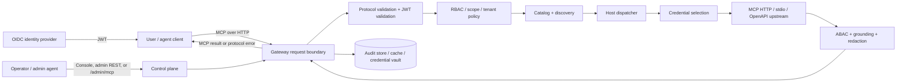
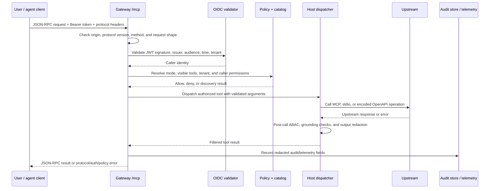
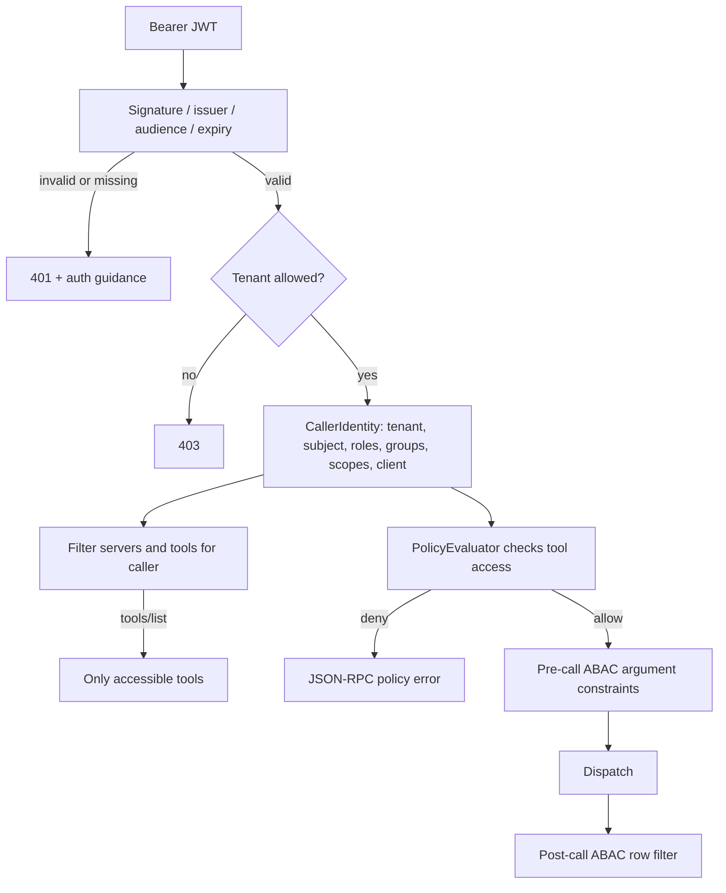
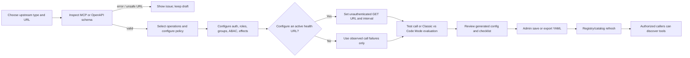
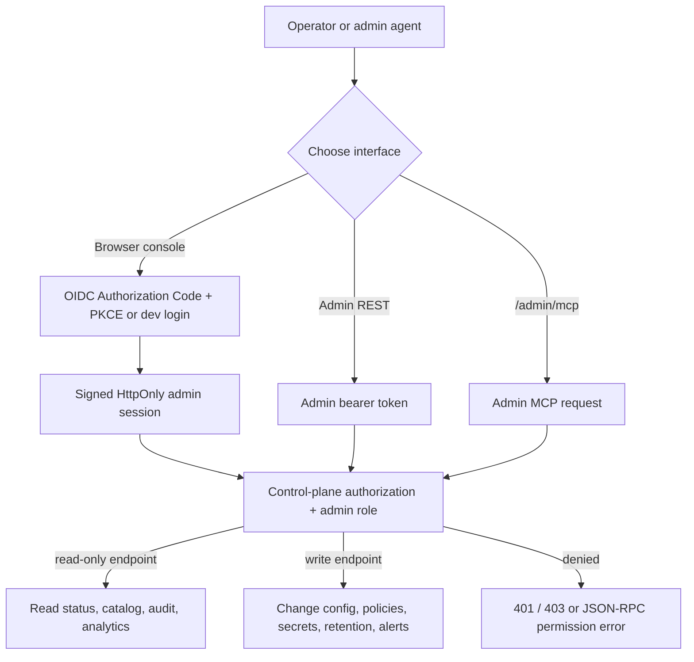
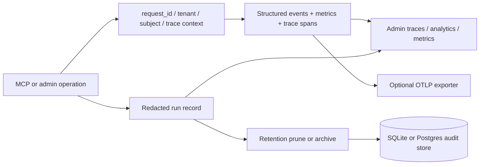
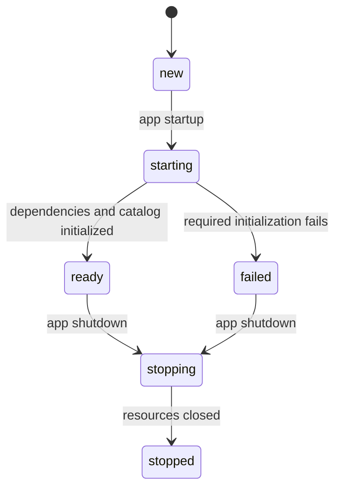
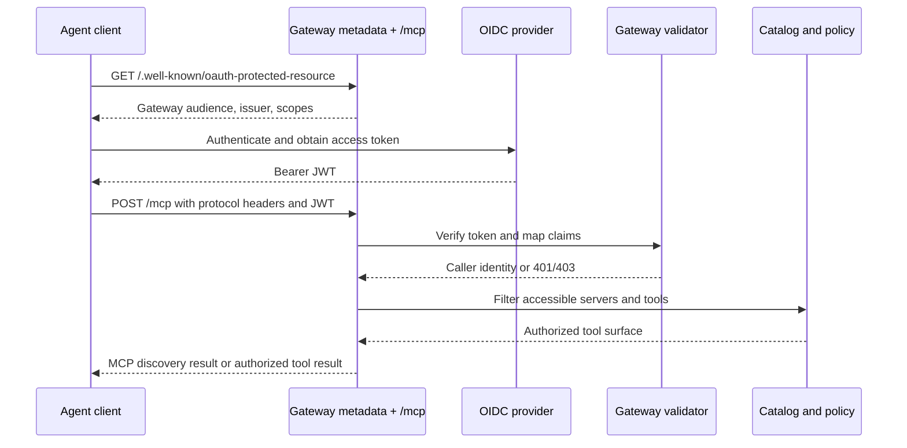
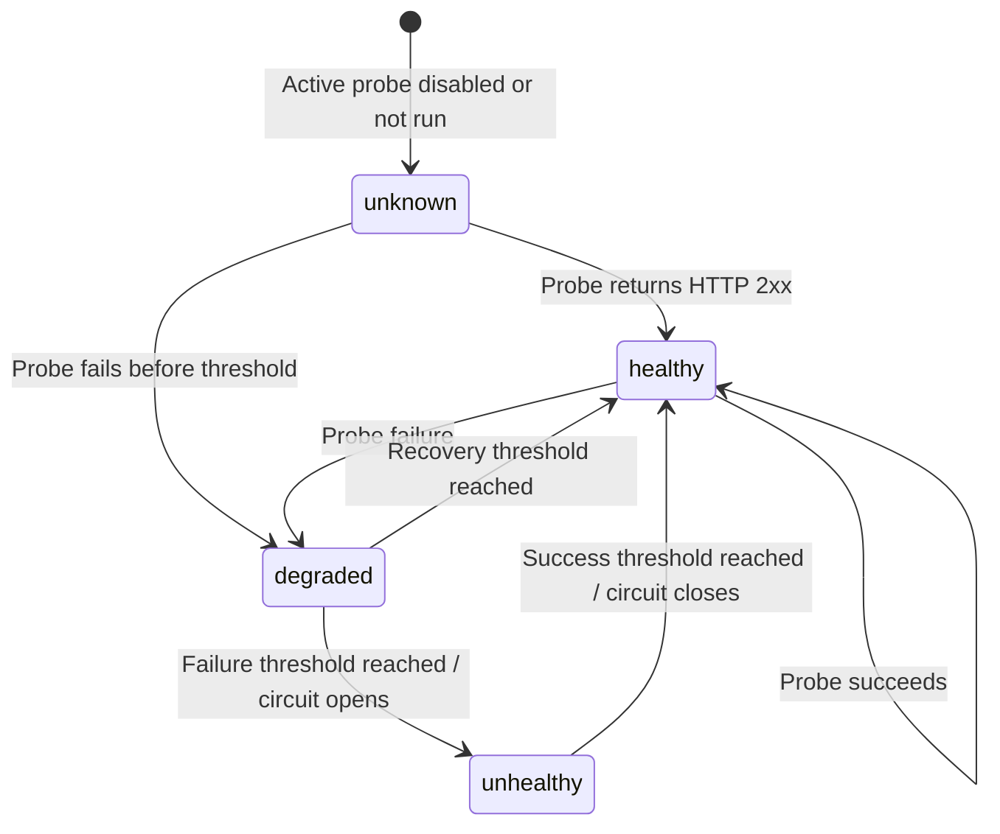

# Gateway Flow Map

This is the agent-facing map of how MCPcodeaway is used and how requests move
through the gateway. It is a navigation guide: implementation in the linked
modules is authoritative. The map covers the main caller, operator, and runtime
journeys; individual endpoints and provider-specific variants are grouped under
their owning flow.

## Start here

| If you need to understand... | Start with... |
| --- | --- |
| A normal MCP tool call | [Caller request flow](#1-caller-request-flow) |
| Why a caller can or cannot see/call a tool | [Identity and access flow](#2-identity-and-access-flow) |
| Downstream credentials | [Credential selection and linking](#3-credential-selection-and-linking) |
| Classic, Code Mode, Hybrid, or Auto | [Discovery and execution flow](#4-discovery-and-execution-flow) |
| Confirmations and manager approvals | [Protected action flow](#5-protected-action-flow) |
| Adding or changing an upstream | [Operator onboarding and configuration](#6-operator-onboarding-and-configuration) |
| The admin console or admin MCP endpoint | [Admin access and operations](#7-admin-access-and-operations) |
| Audit, traces, metrics, and retention | [Evidence and operations flow](#8-evidence-and-operations-flow) |
| Startup, readiness, upstream outage, or recovery | [Gateway lifecycle and failure paths](#9-gateway-lifecycle-and-failure-paths) and [upstream monitoring](#11-upstream-monitoring-and-error-recovery) |
| Which routes, pages, and tests cover a journey | [Flow inventory and coverage](#10-flow-inventory-and-coverage) |

## System at a glance



The gateway's MCP HTTP calls are sessionless: each request supplies its own
identity and arguments. Durable business state (for example credentials,
configuration, approval state, and audit records) belongs in the configured
store. Opt-in recovery for explicitly idempotent direct writes persists an
encrypted operation record. MCP Tasks clients poll that record; other clients
use the read-only `get_operation_status` tool. The gateway does not retain an
MCP connection or send later notifications to the original client.

## 1. Caller request flow

The normal request is a sequence of gates. Any failed gate returns an error and
does not continue to a protected upstream call.



**Entry and owners:** `POST /mcp` in `gateway.server.mcp_endpoint`; protocol
checks in `server._validate_modern_mcp_request`; token validation in
`gateway.auth.OidcTokenValidator`; catalog and access decisions in
`gateway.catalog` and `gateway.auth.PolicyEvaluator`; dispatch in
`gateway.dispatcher.HostDispatcher`; network calls in
`gateway.upstream_clients.UpstreamClientManager`.

**Important branches:** `server/discover` and `tools/list` return a caller's
accessible tool surface; `tools/call` dispatches one tool; invalid JSON-RPC or
protocol metadata is rejected; bad/missing identity is HTTP 401, an untrusted
tenant is HTTP 403, and policy denial is a JSON-RPC tool error. Request
concurrency limits can reject with HTTP 503 before the handler runs.

## 2. Identity and access flow



Caller identity comes from the configured OIDC issuer (Entra, Keycloak, or
another compatible issuer). Local development tokens use the development
identity provider when enabled. Admin identities use the separate admin
authentication flow in section 7. Admin roles do not make ordinary user calls
skip the request, policy, or data-filtering checks.

Entra group-overage markers (`hasgroups` or `_claim_names.groups`) mark group
membership as incomplete. When `entra_group_overage_resolution_enabled` is on,
the validator resolves transitive group IDs through Microsoft Graph using a
tenant-specific OBO token and caches them by tenant and Entra object ID for the
configured short TTL. Resolution failure leaves membership incomplete; any
group-dependent server or ABAC rule denies access. Role and scope checks remain
independent. Enabling this requires Graph delegated permissions and tenant
admin consent for the configured `entra_graph_scope`; the gateway does not
synchronize directory data.

## 3. Credential selection and linking

After caller authorization, the dispatcher resolves downstream credentials from
the upstream's configured `auth_type`:

| `auth_type` | Credential path |
| --- | --- |
| `delegated_token` | Exchange the caller token for a downstream token (Entra OBO or RFC 8693); cache is scoped by caller/tenant/audience. |
| `client_credentials` | Obtain or reuse a gateway service token from the client-credentials provider/cache. |
| `api_key` / `bearer_secret` | Resolve configured secret reference through `SecretResolver`; attach only to the outbound host request. |
| `user_oauth` / `user_api_key` | Load the caller's OAuth credential from process memory (PostgreSQL backend) or encrypted API key from `CredentialVault`; refresh OAuth when needed. Missing credentials return an actionable connect link/form. PostgreSQL-backed OAuth requires reconnect after restart or when routed to another replica. |
| `none` | Send no downstream credential; gateway identity and policy still apply. |

Secret and URL validation is performed before outbound use. In particular,
user/admin-supplied upstream URLs are checked by `validate_upstream_url`, and
OpenAPI path parameter values are URL encoded. In production, HTTP upstream
connections resolve and validate all IPv4 and IPv6 destinations for each
request, connect only to those validated addresses, verify the connected peer,
and do not follow redirects. Explicit `allowed_upstream_hosts` entries permit
private corporate API addresses, while metadata, link-local, loopback, and
other prohibited destinations remain blocked. The pinned upstream transport is
separate from shared OIDC and credential HTTP clients.

For Entra OBO, configure an HTTPS token endpoint on the same authority host as
the validated OIDC issuer, with the verified tenant ID in the authority path
or a `{tenant_id}` path placeholder. Configure an audience and a scope belonging
to that same downstream resource (normally its `/.default` scope), and grant
the confidential client the corresponding delegated permissions and consent.
Claims challenges returned by the token authority are surfaced in
`WWW-Authenticate`; OBO errors never fall back to client credentials.

### Per-user OAuth or API key link

```mermaid
sequenceDiagram
    participant C as Caller
    participant G as Gateway /auth/connect
    participant X as External provider
    participant V as CredentialVault
    C->>G: Authorized tool call needs an unlinked credential
    G-->>C: Tool error with signed, short-lived connect URL
    C->>G: Open connect URL
    alt OAuth
        G-->>C: Redirect to provider with state + PKCE
        C->>X: Sign in and consent
        X->>G: Callback with code + state
        G->>X: Exchange code with PKCE verifier
        X-->>G: Tokens
    else API key
        G-->>C: Secret-entry form
        C->>G: Submit secret over HTTPS
    end
    G->>V: Encrypt and store by tenant + subject + upstream
    G-->>C: Linked; retry original tool call
```

Owners: `gateway.user_connect`, `gateway.crypto`, `gateway.secrets`, and
`gateway.dispatcher`. Personal credential linking and lifecycle operations are
API/integration-driven through `/me/connections` and
`/auth/connect/{upstream_name}`; the gateway does not provide an end-user
identity or credential-management portal. Credentials are isolated to the
caller and tenant, and are never intended to be pasted into an agent
conversation. In PostgreSQL deployments, per-user OAuth tokens remain
process-local, so users reconnect after a restart or replica change; encrypted
per-user API keys are durable.

## 4. Discovery and execution flow

Execution mode and discovery strategy are selected independently. The caller
may use legacy `mode` presets or execution/discovery query parameters and
headers; `X-Intent` can narrow discovery. Auto selection and per-tool overrides
can further select an execution strategy.

| Strategy | Caller experience | Gateway behavior |
| --- | --- | --- |
| Classic | List tools and call one tool directly. | Return the authorized catalog and dispatch the named call. |
| Code Mode | Discover tools as needed, then call `execute_code`. | Run Python in the Monty sandbox; host tool stubs invoke separately authorized upstream calls. |
| Hybrid | Both direct-call and `execute_code` tools are available. | Keep writes/direct operations available while enabling bundled read workflows. |
| Auto | Send an intent or request a routing decision. | Choose a strategy from request/model/workload signals; record the decision and reason. |

Mode resolution in the MCP endpoint is deterministic. An authorized operator
force-mode header takes precedence; otherwise a caller's legacy `mode` query or
`X-Gateway-Mode` selects a preset, while `execution` / `X-Execution-Mode` and
`discovery_mode` / `X-Discovery-Mode` can override their respective axes. With
no fixed execution request, the endpoint starts in Auto. For a targeted tool
call, a configured per-tool override takes precedence over automatic selection.
If no tool override applies, a non-`auto` upstream `preferred_mode` applies
when the target upstream can be identified or all in-scope upstreams agree; an
explicit discovery setting or intent discovery choice remains independent.
Otherwise Auto tries the
configured Classic-versus-Code experiment for eligible read-only workloads,
then eligible model-profile and adaptive evidence, then the request/workload
scorer. A/B assignment changes the execution axis only and retains the
resolved discovery strategy. The selected
mode and decision reason, and any experiment id and variant, are recorded with
the execution telemetry.

When a target tool is known, a `read_only_only` experiment checks that tool's
effect classification. For untargeted workflows, it checks the full candidate
upstream tool set and excludes mixed read/write upstreams. Auto strategy
selection does not alter tool permissions, effects, credentials, or approval
requirements.

Discovery may be upfront (`tools/list`), deferred (`discover_tools` /
`search_tools`), or intent-filtered. The catalog is populated from configured
upstreams during startup or an admin refresh. HTTP MCP upstreams use MCP
discovery and tool listing; OpenAPI specs are turned into tools; stdio
upstreams use their configured process transport. Discovery failures are
surfaced as startup warnings and may be retried.

For Code Mode, sandboxed code has no direct filesystem, environment, import, or
socket access. Tool calls cross a host-controlled bridge, where the gateway
rechecks authorization, arguments, credentials, and output controls. Optional
grounding verifies returned entity identifiers against host-observed results.

Owners: `gateway.server` (mode resolution and MCP entry), `gateway.catalog`,
`gateway.discovery`, `gateway.sandbox`, and `gateway.dispatcher`.

## 5. Protected action flow

Reads normally dispatch immediately. A configured write can require requester
confirmation. Existing high-impact manager approval remains available only
through configured policy and the external approval API; onboarding does not
offer it and the built-in inbox is hidden.

```mermaid
stateDiagram-v2
    [*] --> Request
    Request --> AuthAndPolicy: authenticate and authorize
    AuthAndPolicy --> Dispatch: unprotected call
    AuthAndPolicy --> Confirm: confirmation required
    Confirm --> Declined: caller declines
    Confirm --> Pending: caller accepts; persist exact action digest
    Pending --> Approved: eligible approver approves
    Pending --> Denied: eligible approver denies
    Pending --> Expired: TTL elapsed
    Pending --> Invalidated: policy changes
    Approved --> Recheck: caller retries exact request
    Recheck --> Dispatch: re-auth, re-authorize, atomic one-time claim
    Recheck --> Invalidated: mismatch, replay, or caller no longer authorized
    Dispatch --> [*]
```



Confirmation is bound to caller, tenant, tool, exact arguments, and policy
version. The original request does not stay open while waiting. A manager
approver cannot approve their own request; only one eligible group decision is
needed. Code Mode cannot bypass a protected direct tool call. The state machine
and edge cases are described in [state-machines.md](state-machines.md) and
[approval-gate-enhancements.md](approval-gate-enhancements.md).

Before dispatching a write or high-impact tool, the dispatcher durably records
`prepared`, then atomically claims it as `executing`. It records `succeeded`,
`failed`, or `outcome_unknown` after the attempt. The record contains tenant,
caller, tool, request digest, and correlation ID, but not raw arguments or
credentials. If the required audit store cannot prepare the record, the
upstream side effect is not started. If final audit persistence fails after an
upstream success, the operation is treated as uncertain and its existing claim
prevents a duplicate execution with the same correlation and request.

Owners: `gateway.server` approval request/continuation handlers and
`gateway.state` durable nonce and approval state. The approval API is available
to external workflow clients; the built-in console inbox is currently hidden.

## 6. Operator onboarding and configuration



The onboarding UI is `web/app/pages/onboarding.vue`; relevant APIs include
`GET /admin/upstreams/agent-prompt`, `POST /admin/upstreams/inspect`,
`POST /admin/upstreams/test-call`, `POST /admin/upstreams/ab-test`, and
`POST /admin/upstreams`. The CLI path is `gateway add-mcp`. Production
configuration must explicitly allowlist operations and classify their effects;
discovery alone does not make an operation available to callers.

Configuration changes, secret edits, tool mode/guidance/approval policy edits,
catalog refresh, and upstream deletion go through the admin control plane.
These actions require the relevant admin authorization and may refresh the
catalog so subsequent caller discovery reflects the new state.

## 7. Admin access and operations



Admin console API calls share `web/app/composables/useAdminApi.ts`; browser
authentication and session endpoints live in `gateway.admin_auth`. The server's
`_authorize_control_plane` enforces the control-plane authorization contract.
Read-only `/admin/*` endpoints may allow an `operator_viewer`; mutations require
an admin role. The self-admin MCP surface at `/admin/mcp` exposes a subset of
operator actions as tools and uses the same authorization checks.

The route families line up with these operator tasks:

| Operator task | Route families |
| --- | --- |
| Sign in, check, or end an admin session | `/auth/admin/config`, `/auth/admin/login`, `/auth/admin/callback`, `/auth/admin/session`, `/auth/admin/logout`; dev/token login is available only when configured. |
| Inspect, register, edit, test, refresh, or remove upstreams | `/admin/upstreams*`, `/admin/catalog/refresh` |
| Review and decide protected actions through an external workflow client | `/admin/approvals*` |
| Inspect live gateway and usage evidence | `/admin/telemetry/*`, `/admin/discovery/*`, `/admin/adaptive-execution/*`, `/admin/ab/*`, `/admin/routing/*`, `/audit/analytics` |
| Tune policies, routing, alerts, pricing, and demo traffic | `/admin/upstreams/*`, `/admin/alerts/*`, `/admin/routing/*`, `/admin/pricing/*`, `/admin/demo/*` |
| Maintain audit evidence and secrets | `/admin/audit/*`, `/admin/secrets/*` |

The route families are intentionally grouped by operator intent; inspect the
route definitions and profile gates in `gateway.server` for the exact method,
role requirement, and availability in a given deployment profile.

The console's main journeys are:

- **Observe:** dashboard, upstream health, traces, analytics, audit, model
  performance, optimization, alerts, and runtime telemetry.
- **Configure:** upstream onboarding/editing, access and effect policies,
  tool guidance/mode, model routing/pricing, A/B settings, and alert rules.
- **Operate:** catalog refresh, demo traffic, audit retention,
  audit archive, adaptive evidence/settings, and incident inspection.

Each page owns its loading, empty, success, and error states. See
[`web/app/pages/`](../web/app/pages/) and the endpoint inventory in
[`server.py`](../src/gateway/server.py).

## 8. Evidence and operations flow



Run records and persisted output fields are redacted before storage. Audit
queries are tenant-scoped for non-admin callers. `/metrics` provides
Prometheus-format metrics when enabled; `/audit/*` exposes caller-scoped audit
and value views; admin APIs provide broader analytics, traces, archive, and
retention controls. Optional OpenTelemetry spans/events can be exported to an
OTLP endpoint. Redis is used for selected cross-request coordination and cache
state, not MCP sessions. SQLite/Postgres owns durable audit and encrypted
non-OAuth user credential records; PostgreSQL also coordinates approvals and
sensitive writes. OAuth tokens are process-local and never stored in PostgreSQL.

Owners: `gateway.observability`, `gateway.telemetry`, `gateway.state`, and the
audit/admin routes in `gateway.server`.

## 9. Gateway lifecycle and failure paths



At startup, `GatewayRuntime` selects settings, cache, audit store, auth
providers, registry, clients, catalog, sandbox, and telemetry; validates
production secrets; initializes dependencies; and attempts catalog discovery.
Transient discovery problems are warnings/retries where supported. Readiness
requires the runtime to be `ready` and its required dependencies healthy. At
shutdown, background tasks and clients are closed.

Common short-circuit outcomes:

| Condition | Resulting path |
| --- | --- |
| Origin, JSON-RPC shape, or MCP protocol metadata invalid | Reject at the gateway boundary; no upstream call. |
| Missing/invalid JWT or forbidden tenant | HTTP 401/403 with authentication guidance. |
| Caller cannot access server/tool or argument violates policy | JSON-RPC error; no protected dispatch. |
| Upstream URL is unsafe or configuration is invalid | Reject before outbound request; admin inspection/configuration reports the issue. |
| Per-user credential missing | Return signed connect instructions; no upstream call. |
| Upstream fails or times out | Return tool/protocol error and record outcome, with redaction on persisted fields. |
| Grounding check fails | Block the ungrounded result. |
| Output contains sensitive values | Redact before returning and before persisting audit output. |
| MCP concurrency capacity is exhausted | HTTP 503 with `Retry-After`. |
| Optional telemetry/exporter unavailable | Surface degraded telemetry separately; it does not imply request success or failure by itself. |

## 10. Flow inventory and coverage

This inventory is the completeness checklist for supported journeys. A row may
point to a more detailed flow above or to an existing focused guide. “Test
evidence” names relevant tests; those tests exercise representative cases and
do not imply exhaustive branch coverage.

### Identity, connection, and caller journeys



Tool discovery does not grant access by itself. A later tool call is
authenticated and authorized again using that request's identity.

| Journey | Main route / surface | Important branches | Implementation and test evidence |
| --- | --- | --- | --- |
| Discover gateway authentication requirements | `/.well-known/oauth-protected-resource`, `/.well-known/oauth-authorization-server` | External OIDC issuer; local dev OIDC metadata when enabled. | `gateway.oauth_discovery`; `tests/test_auth_obo.py::test_oauth_discovery_and_dev_token_endpoints` |
| Obtain and inspect caller identity | IdP token → `GET /auth/me` → `POST /mcp` | Invalid signature/issuer/audience/expiry → 401; unapproved tenant → 403; valid claims map to roles, groups, scopes, client, and tenant. | `gateway.auth`; `tests/test_auth_obo.py`, `tests/test_mock_oidc_provider.py` |
| Use local development identity | `GET /dev/oidc/jwks`, `POST /dev/auth/token` | Enabled only for development profiles; unknown persona or disabled endpoint is rejected. | `gateway.oauth_discovery`; `tests/test_auth_obo.py` |
| Connect an agent and discover tools | `POST /mcp` with current MCP metadata and headers | `server/discover`, `tools/list`, paginated/deferred discovery, intent-filtered surface; malformed or old protocol metadata is rejected. | `gateway.server`, `gateway.catalog`, `gateway.discovery`; `tests/test_discovery_system1.py`, `tests/test_profiles_and_observability.py` |
| Reject invalid caller, protocol, or tool input | `POST /mcp` → authentication and protocol boundary → schema validation | Invalid bearer is HTTP 401; unsupported protocol version is HTTP 400; missing required tool input returns JSON-RPC invalid-params without dispatch. | `tests/golden/flows.json` (`mcp_invalid_bearer_fails_closed`, `mcp_unsupported_protocol_version_rejected`, `mcp_missing_required_tool_argument_rejected`); `tests/test_golden_flows.py` |
| Make a direct tool call | `POST /mcp` → `tools/call` | Allow/deny; argument validation; approval gate; upstream success/error; filtered and redacted result. | Sections 1–5; `tests/test_golden_flows.py`, `tests/test_gateway_modes_e2e.py` |
| Recover from an upstream call failure | Direct tool → typed error contract or durable operation record | Reads may retry once. Writes replay only when an admin enables recovery, configures a string idempotency-key argument and upstream key retention, and the API honors that key. A client that opts into MCP Tasks polls `tasks/get`; other clients receive an operation ID and use `get_operation_status`. Code Mode scripts are never resumed or replayed. | Section 11; `tests/test_upstream_recovery_golden.py`, `tests/test_mcp_task_recovery.py`, `tests/test_upstream_monitoring.py` |
| Inspect pending write recovery | `GET /admin/operations`; MCP task polling or `get_operation_status` | Tenant-scoped read-only operator view; task and operation reads reauthorize the original caller; bounded retries end in a confirmed result or `needs_attention`. | `gateway.recovery`, `/admin/operations`; `tests/test_mcp_task_recovery.py` |
| Demonstrate write recovery | Demo Control → Recovery Lab | Runs fresh end-to-end MCP Task, idempotent replay, changed-payload rejection, and legacy status fallback checks against an isolated in-process mock. It never calls registered upstreams and is available only in the demo profile. | `examples.recovery_lab`, `/admin/demo/recovery/run`; `tests/test_recovery_lab.py`, `tests/golden/flows.json` (`recovery_lab_flows`) |
| Monitor an upstream API | Onboarding health config → background probe → health table / alert | Off by default; SSRF validation; degraded/unhealthy/recovery thresholds; no caller credential reuse. | `gateway.monitoring`, `gateway.alerts`; golden recovery flows and `tests/test_upstream_monitoring.py` |
| Hit caller rate or gateway concurrency limits | `POST /mcp` → dispatcher sliding-window check or concurrency middleware | Per `(tenant, subject)` call limit produces a tool error; saturated gateway returns HTTP 503 with `Retry-After: 1`. | `gateway.dispatcher`, `gateway.state`, `gateway.server`; `tests/test_scalability.py`, `tests/test_golden_flows.py` |
| Use Code Mode for a multi-tool workflow | `POST /mcp` → `execute_code` → host callbacks | Sandbox timeout/call budget; callback auth/validation; partial upstream failure; provenance/grounding pass or block. | `gateway.sandbox`, `gateway.dispatcher`; `tests/test_sandbox_security.py`, `tests/test_provenance_and_axes.py`, `tests/test_gateway_modes_e2e.py` |
| Link a personal downstream credential | `/auth/connect/{upstream}`, callback or secret form, `/me/connections` | Signed/expired ticket; OAuth state and PKCE validation; token exchange error; encrypted save; list, replace, delete, refresh/expiry, missing credential and retry. | Section 3; `gateway.user_connect`; `tests/test_user_connect.py`, `tests/test_crypto_secrets.py` |
| Continue after requester or manager decision | `input_required` request continuation; `/admin/approvals*`; requester retries original call | Accept/decline; wrong identity; altered args; stale policy; replay; expiration; approver deny/approve; exactly-once claim. | Section 5; `docs/state-machines.md`; `tests/test_approval_golden.py` |

### Operator, deployment, and maintenance journeys

```mermaid
sequenceDiagram
    participant O as Administrator
    participant UI as Console or CLI
    participant G as Gateway control plane
    participant U as Candidate upstream
    participant DB as Config store and local catalog
    participant Cache as Shared cache
    O->>UI: Enter type, URL, auth, and intended operations
    UI->>G: Inspect candidate
    G->>G: Authorize admin; validate URL and SSRF rules
    G->>U: Discover schema or OpenAPI operations
    U-->>G: Tools, schemas, security metadata
    G-->>UI: Inspection, checklist, warnings, or errors
    O->>UI: Curate allowlist, access policy, effect, confirmation
    UI->>G: Register or update upstream
    G->>G: Re-inspect and validate selections and policies
    G->>DB: Persist configuration and refresh local catalog
    G->>Cache: Bump catalog epoch for other replicas
    G-->>UI: Registered configuration and catalog version
    UI-->>O: Show success or actionable failure
```

When dynamic upstream writes are disabled, the operator changes configuration
through the GitOps path and a deployment loads it at startup.

| Journey | Main route / surface | Important branches | Implementation and test evidence |
| --- | --- | --- | --- |
| Admin sign-in and session lifecycle | `/auth/admin/config`, `/auth/admin/login`, `/auth/admin/callback`, `/auth/admin/session`, `/auth/admin/logout`; optional dev/token login | OIDC PKCE success/cancel/state mismatch; role denied; session cookie valid/expired/logout; bearer-token path. | `gateway.admin_auth`, `web/app/composables/useAdminApi.ts`; `tests/test_oidc_golden_flows.py`, `tests/test_phase11_scaling_analytics_ab.py` |
| Inspect and onboard upstream | Console wizard, CLI `gateway add-mcp`, `POST /admin/upstreams/inspect`, `POST /admin/upstreams` | MCP/OpenAPI/stdio inspection; SSRF or inspection error; operation curation; missing role/effect/approval policy; dynamic registration locked; successful catalog refresh. | Section 6; `tests/test_hitl_onboarding_and_abac.py`, `tests/test_openapi_generation_golden.py`, `tests/test_upstream_onboarding.py`, `tests/test_security_hardening.py` |
| Change or remove upstream configuration | `/admin/upstreams*`, `/admin/catalog/refresh`, config/YAML deployment | Mode, tool guidance, secrets, approval policy, delete; approval invalidation on policy change; local catalog update and Redis epoch sync; production GitOps-only path. | `gateway.server`, `gateway.config`, `gateway.state`; `tests/test_phase11_scaling_analytics_ab.py`, `tests/test_approval_golden.py`, `tests/test_profiles_and_observability.py` |
| Review activity and compliance evidence | `/audit/*`, `/admin/audit/*`, audit console | Tenant-scoped caller views; admin view; not found/forbidden; retention prune/archive success or store error. | Section 8; `gateway.state`; `tests/test_security_hardening.py`, `tests/test_phase15_ops_and_compliance.py`, `tests/test_phase11_scaling_analytics_ab.py` |
| Inspect traces, analytics, and runtime | Console pages `/traces`, `/analytics`, `/model-performance`, `/optimization`; `/admin/telemetry/runtime`, `/admin/discovery/report`, `/admin/adaptive-execution/report` | No or sparse data; store/worker unavailable; live WebSocket reconnect; data remains tenant- or role-scoped as applicable. | `web/app/pages/*`, `gateway.telemetry`, `gateway.runtime_stats`; `tests/test_phase11_scaling_analytics_ab.py`, `tests/test_adaptive_execution.py` |
| Tune execution and model routing | `/admin/adaptive-execution/*`, `/admin/ab/*`, `/admin/routing/*`, `/admin/pricing/*`, onboarding A/B test | Insufficient/stale evidence; quality regression; tenant-scoped evidence import; recommendation vs active rollout; experiment assignment. | `gateway.adaptive_execution`, `gateway.ab_testing`; `tests/test_adaptive_execution.py`, `tests/test_phase11_scaling_analytics_ab.py` |
| Operate alerts, demo traffic, and alerts webhook | `/admin/alerts*`, `/admin/demo/traffic*`, `/admin/demo/models*`, `/admin/demo/golden-run` | Golden run sends listing/search plus local mock reads/writes; covers replay/conflict, rejection, delayed and lost responses, pending reconciliation, task polling, and RBAC denial; visible recovery records; paired simulated evidence stays excluded from routing. `/admin/demo/workflow-evidence` remains a compatibility alias. | `gateway.alerts`, `gateway.demo_traffic`, `recovery_workbench`; `tests/test_demo_traffic.py`, `tests/test_adaptive_execution.py`, `tests/test_phase15_ops_and_compliance.py`, `tests/test_phase11_scaling_analytics_ab.py` |
| Use admin MCP tools | `POST /admin/mcp` → `server/discover`, `tools/list`, `tools/call` | Admin/viewer authorization; read-only vs mutating tool; permission/error result. | `gateway.admin_mcp`; `tests/test_adaptive_execution.py`, `tests/test_phase15_ops_and_compliance.py` |
| Use optional dashboard, compare, and benchmark surfaces | `/dashboard/*`, `/compare/run`, `/benchmarks/latest` | Available only in profiles with features enabled; production barebones profile returns 404 for disabled surfaces. | `gateway.profiles`, `gateway.server`; `tests/test_profiles_and_observability.py`, `tests/test_golden_flows.py` |
| Scale replicas and isolate execution | Gateway HTTP replicas, Redis/Postgres, local or remote sandbox worker | Catalog epoch sync; OBO/rate-limit isolation; worker unavailable; shared dependency loss; clean shutdown; upstream circuit convergence and recovery through the load balancer. | `docs/cloud_scalability.md`; `tests/test_cross_replica_isolation.py`, `tests/test_scalability.py`, `tests/test_upstream_recovery_golden.py`, `scripts/readiness_smoke.py` |
| Recover startup discovery after a transient outage | Startup discovery → warning → bounded rediscovery → catalog restored | Discovery succeeds after an initial failure; warning clears after recovery; retries stop after bounded attempts. | `GatewayRuntime._retry_failed_startup_upstreams`; `tests/test_golden_flows.py::test_startup_discovery_recovers_after_transient_failure` |

### Full externally visible route map

Use this as a route-family index. Feature profiles may omit a family, and
authorization varies by read/write operation. The route handlers remain the
source of truth for methods and policy.

| Surface | Routes / families | Flow |
| --- | --- | --- |
| Health and protocol metadata | `/health`, `/ready`, `/.well-known/*`, optional `/dev/*` | Startup and caller authentication discovery. |
| Caller identity and tools | `/auth/me`, `/mcp` | User authentication, discovery, tool execution. |
| Personal connections | `/auth/connect/*`, `/me/connections*` | OAuth/API-key linking and lifecycle. |
| Admin identity | `/auth/admin/*` | OIDC PKCE, optional development/bearer login, session management. |
| Upstream control | `/admin/upstreams*`, `/admin/catalog/refresh`, `/admin/upstreams/agent-prompt`, `/admin/upstreams/inspect`, `/admin/upstreams/test-call` | Inspect, onboard, edit policy/mode, test, refresh, delete. |
| Approval control API | `/admin/approvals*` | List eligible actions and approve/deny them from an external workflow client; the built-in console inbox is currently hidden. |
| Admin MCP | `/admin/mcp` | Expose a subset of control-plane operations as MCP tools. |
| Audit and value | `/audit/*`, `/admin/audit/*` | Caller-scoped audit, admin retention/archive, analytics/value. |
| Runtime and discovery | `/admin/telemetry/*`, `/admin/discovery/*`, `/admin/adaptive-execution/*` | Gateway/worker status, observed tool health, evidence, recommendations. |
| Routing and experiments | `/admin/ab/*`, `/admin/routing/*`, `/admin/pricing/*`, `/admin/upstreams/ab-test` | A/B settings, model routing/pricing, evaluation. |
| Operations | `/admin/alerts/*`, `/admin/demo/*`, `/admin/secrets/*`, `/admin/roles` | Alerts, demo traffic/models, gateway secrets, role inspection. |
| Live console stream | `/admin/ws/telemetry` | Authenticated initial snapshot and live events; reconnect/disconnect behavior. |
| Optional product surfaces | `/dashboard/*`, `/compare/run`, `/benchmarks/latest` | Console SPA, side-by-side execution, benchmark artifact; profile-gated. |
| Metrics | `/metrics` | Prometheus metrics, profile/auth controlled. |

### Live telemetry and browser-agent journeys

The console's WebSocket starts in `idle`, connects to `/admin/ws/telemetry`,
receives an initial snapshot and runtime ticks, and then receives run events.
Unexpected close/error schedules a reconnect after 2.5 seconds. Explicit
disconnect cancels the timer and ends in `disconnected`. Server-side
authorization and profile gates still apply after a reconnect. This stream is
live delivery; audit storage remains the durable source for historical runs.

The optional in-browser agent bridge (`web/app/composables/useUiAgent.ts`)
initializes once in the browser, registers tools, and checks WebMCP availability.
When a tool step requests confirmation, it displays a pending prompt; accept
resolves the step as allowed, decline or abort resolves it as denied. This UI
confirmation is separate from the gateway's server-enforced tool approval
policy in section 5.

## 11. Upstream monitoring and error recovery

The current health behavior should be read as three separate signals:

| Signal | Current behavior | What it does not mean |
| --- | --- | --- |
| Gateway liveness (`GET /health`) | Reports gateway status; production response is intentionally minimal. Non-production responses include profile, catalog and startup warning details. | It does not establish that every downstream API is reachable. |
| Gateway readiness (`GET /ready`) | Requires lifecycle state `ready`; checks configured Redis and Postgres dependencies with a bounded probe. | It does not probe configured upstreams. A single upstream outage does not make the gateway unready. |
| Upstream reachability | Optional configured GET probes run at each upstream's interval. The URL is explicit, SSRF-validated, and called without caller credentials. | A probe is only as representative as the health URL an operator chooses; it does not replace the real tool-call result. |
| Caller-facing failures | The gateway returns a stable `error_type`, safe message, retry eligibility, retry count, status code when available, and write-outcome uncertainty. An explicitly opted-in idempotent direct write can return a task handle or an operation ID while bounded recovery runs. | Raw transport exception text and secrets are not exposed. An ordinary write is never replayed; recovery uses the same upstream key and exact stored arguments only when its contract is configured. |
| Admin visibility | `/admin/adaptive-execution/tool-health` includes per-tool error-category counts and current probe state; `/admin/alerts` includes category breakdowns and alerts on unhealthy probes. | Historical categories depend on telemetry captured after this change; older runs do not have categories. |

The startup recovery flow remains **discovery failure → warning → bounded
background rediscovery → catalog refreshed and warning cleared**. Separately,
configured active probes run continuously. Probe state begins `unknown`, becomes
`degraded` after an initial failure, opens a per-process circuit after the
consecutive-failure threshold, and closes it after the consecutive-success
threshold. While open, calls return `upstream_unhealthy`; probes continue so
recovery can restore traffic. Circuit state is held in each gateway process and
is not shared between replicas.

For recognized transient transport failures (timeout, connection failure, HTTP
429/502/503/504), a read-classified tool receives one gateway retry after a
short delay. For writes, recovery is off by default. An administrator may opt a
direct write into bounded recovery by configuring the upstream's idempotency
argument, synchronous wait budget, total write attempts, maximum recovery age,
and upstream key retention. An optional read-only status tool can reconcile a
commit before the gateway replays the exact call with the same key. An upstream
that does not honor idempotency keys is not safe for this feature.

If the MCP request advertises the Tasks extension, an uncertain call returns a
task handle and the client polls `tasks/get`. Otherwise, the gateway returns an
operation ID and exposes a caller-scoped `get_operation_status` tool. The
original HTTP/MCP connection is not held open, and no server notification is
sent later. After attempt or age limits, unresolved work becomes
`needs_attention`; operators can inspect it in the read-only Operations
Recovery page. The gateway does not offer a manual replay button.

Operation arguments, upstream idempotency keys, and final results are encrypted
at rest with the configured credential-encryption key. A separate stable
`GATEWAY_TASK_DEDUPE_SECRET` protects caller-scoped idempotency fingerprints; it
must remain stable while operation records are retained. Production uses the
shared Postgres store and database claim leases so replicas do not own separate
queues. SQLite supports local development. Code Mode scripts are not persisted
or replayed; clients can inspect operation IDs for direct writes only.

Probe state remains distinct from gateway readiness: an unavailable downstream
does not make `/ready` fail. The onboarding form defaults active checking off;
when enabled, it uses a 30-second interval, 3-second timeout, 3-failure open
threshold, and 2-success recovery threshold. The API allows bounded interval,
timeout, and threshold customization. A dedicated probe should not require
per-user credentials, which are unavailable to a background health task.

```mermaid
sequenceDiagram
    participant A as Agent
    participant G as Gateway
    participant U as Upstream API
    participant M as Health monitor
    participant O as Admin console / alerts
    A->>G: Call tool
    G->>G: Authorize, validate, check configured circuit
    alt Circuit open
        G-->>A: upstream_unhealthy; no upstream call
    else Circuit closed
        G->>U: Invoke tool
        alt Transient error on a read
            U-->>G: Timeout, connection error, or retryable HTTP status
            G->>U: Retry once
            U-->>G: Result or typed failure
        else Write failure
            U-->>G: Error or lost response
            G-->>A: Typed failure; outcome_unknown when delivery is uncertain
        else Success
            U-->>G: Tool result
            G-->>A: Filtered, redacted result
        end
    end
    loop Configured probe interval
        M->>U: Unauthenticated GET to health URL
        alt Success threshold reached
            M->>G: Close circuit and mark healthy
        else Failure threshold reached
            M->>G: Open circuit and mark unhealthy
        end
        O->>G: Poll tool-health and alerts endpoints
        G-->>O: Probe state, error categories, and alert evidence
    end
```



## Executable journey crosswalk

These are selected golden journeys, not an exhaustive test of every branch in
this document. Their JSON files are test inputs; add a scenario there only when
the corresponding runner supports it.

| Journey | Golden scenario / test |
| --- | --- |
| Tool visibility and RBAC | `rbac_deny_support_finance` in [`tests/golden/flows.json`](../tests/golden/flows.json), [`test_golden_flows.py`](../tests/test_golden_flows.py) |
| Row-level isolation and ABAC/redaction | `obo_rls_eu_vs_us_isolation`, `abac_post_filter_and_pii_redaction` in [`tests/golden/flows.json`](../tests/golden/flows.json) |
| Code Mode grounding and compression | `codemode_reconcile_overdue_grounded`, `grounding_blocks_hallucinated_id` in [`tests/golden/flows.json`](../tests/golden/flows.json) |
| Auto routing | `auto_mode_algorithmic_routing` in [`tests/golden/flows.json`](../tests/golden/flows.json) |
| Admin role, tenant isolation, and production profile | `admin_rbac_and_tenant_audit_isolation`, `profile_production_barebones_gate` in [`tests/golden/flows.json`](../tests/golden/flows.json) |
| Requester confirmation and replay/tampering | [`tests/golden/approval_flows.json`](../tests/golden/approval_flows.json), [`test_approval_golden.py`](../tests/test_approval_golden.py) |
| Manager approval | `separate_group_approves_exact_action_once` in [`tests/golden/approval_flows.json`](../tests/golden/approval_flows.json) |
| OIDC admin login/session | [`test_oidc_golden_flows.py`](../tests/test_oidc_golden_flows.py) |
| Downstream authentication variants | [`docs/auth_spectrum_flows.md`](auth_spectrum_flows.md), [`tests/test_auth_spectrum_golden.py`](../tests/test_auth_spectrum_golden.py) |
| Per-user OAuth/API-key connections | [`tests/test_user_connect.py`](../tests/test_user_connect.py) |
| Error categories, safe retry, probe thresholds, ambiguous write outcome, and circuit recovery | [`tests/test_upstream_monitoring.py`](../tests/test_upstream_monitoring.py), [`tests/test_upstream_recovery_golden.py`](../tests/test_upstream_recovery_golden.py), scaled [`scripts/readiness_smoke.py`](../scripts/readiness_smoke.py) |

## Code and documentation index

- Runtime assembly, lifecycle, route registration, MCP and admin HTTP routes:
  [`src/gateway/server.py`](../src/gateway/server.py)
- Identity and caller policy: [`src/gateway/auth.py`](../src/gateway/auth.py)
- Tool registry/catalog: [`src/gateway/config.py`](../src/gateway/config.py),
  [`src/gateway/catalog.py`](../src/gateway/catalog.py)
- Discovery and upstream transport:
  [`src/gateway/discovery.py`](../src/gateway/discovery.py),
  [`src/gateway/upstream_clients.py`](../src/gateway/upstream_clients.py)
- Failure classification and upstream health monitoring:
  [`src/gateway/errors.py`](../src/gateway/errors.py),
  [`src/gateway/monitoring.py`](../src/gateway/monitoring.py)
- Credential selection and dispatch:
  [`src/gateway/dispatcher.py`](../src/gateway/dispatcher.py),
  [`src/gateway/secrets.py`](../src/gateway/secrets.py),
  [`src/gateway/user_connect.py`](../src/gateway/user_connect.py)
- Admin JSON-RPC tools: [`src/gateway/admin_mcp.py`](../src/gateway/admin_mcp.py)
- Sandbox and execution: [`src/gateway/sandbox.py`](../src/gateway/sandbox.py),
  [`src/gateway/sandbox_worker.py`](../src/gateway/sandbox_worker.py)
- Protocol and detailed state transitions:
  [`docs/state-machines.md`](state-machines.md)
- Authentication provider variants:
  [`docs/auth_spectrum_flows.md`](auth_spectrum_flows.md)
