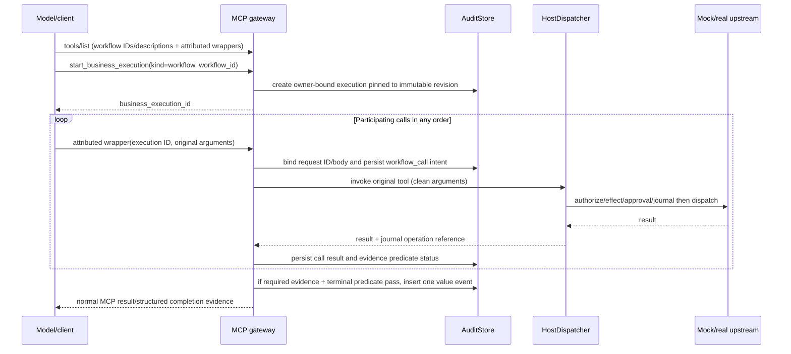

# Interactive Experiences and Business Value: Implementation Plan

This plan implements the architecture in [Interactive MCP Experiences and Business Value Design](interactive-experiences-business-value-design.md). It is intentionally scoped to MCPcodeaway's gateway and console; it does not introduce an agent orchestrator, workflow engine, credential service or external event bus.

## Product experience contract

Workflow definitions are created during upstream onboarding from the tools in the discovered catalog. The first release provides a simple visual builder: an administrator can create multiple workflows for one integration, choose tools, arrange them in a readable descriptive order, mark required evidence, choose terminal completion evidence and set a human-time baseline with its source/confidence. The order is for the administrator to explain the work; it is not an enforced runtime sequence. Business Value is a report-only view. The manifest remains a storage/API format behind the builder and is not the administrator-facing authoring experience.

Attribution is explicit in v1: the caller selects a published workflow ID before attributed calls begin. The gateway does not passively infer which workflow a tool sequence represents. Automatic matching/classification may be designed later, after ambiguity and overlap behavior are specified.

## Implementation invariants

- Tool authorization remains independent from workflow attribution. The ID is never a grant.
- Every upstream operation reaches `HostDispatcher.invoke_tool`; no direct UI or Code Mode bypass.
- Ordinary upstream tool schemas remain unchanged. Attributed calls use gateway-owned wrapper tools with a closed `{business_execution_id, arguments}` envelope; validate the nested original schema, then strip the envelope before original validation, approval digests, journal digests and upstream dispatch. Code Mode uses its gateway-owned `execute_code` envelope.
- Keep the outer JSON-RPC `request_id` and sensitive-write `correlation_id` semantics unchanged. Persist a distinct per-dispatch `workflow_call_id` linked to outer request, telemetry run/subcall, dispatcher invocation and journal operation ID.
- Recheck current tenant, caller, server ceiling, tool policy, ABAC, current effect and current approval policy on every tool call.
- Only deterministic, version-pinned evidence creates one business-value event. Unknown outcome means no credit.
- Published integration/workflow definitions and baseline assumptions are immutable revisions. Existing executions retain their pinned baseline/version.
- Apps are optional; normal tools/text results remain complete without UI support.
- Preserve token savings and current efficiency reporting as Technical Efficiency.

## Runtime flows and mock contract

### Model-declared multi-tool workflow



`participating_tools` controls which calls may be attributed. `required_evidence` controls which successful logical calls and optional result predicates must be present. The terminal `completion` predicate is evaluated after those prerequisites; no ordering or branching is imposed. A missing/failed prerequisite leaves the execution without a value event even if the terminal tool succeeded.

### Standalone invocation and retry

```mermaid
sequenceDiagram
    participant C as MCP client
    participant G as MCP gateway
    participant S as AuditStore
    participant D as HostDispatcher
    C->>G: start(kind=standalone_tool, tool_value_id)
    G->>S: create standalone execution
    G-->>C: business_execution_id
    C->>G: attributed selected-tool call (request ID R, body B)
    G->>S: bind (R,B), atomically claim initial call_key K
    G->>D: dispatch once through existing safety path
    D-->>G: result/journal status
    G->>S: persist result and at most one completion event
    Note over C,S: unresolved retry must reuse R and B, resolving to K
    C->>G: retransmit same unresolved request (R,B)
    G->>S: return/reconcile K; never blind redispatch
    Note over C,G: a new request ID produces a distinct key and is rejected under this execution
```

For several different operations that form one user task, start a workflow. A new standalone task gets a new execution ID. Request-ID reuse with a changed body is rejected. These gateway rules do not replace upstream idempotency or the sensitive-write journal.

### MCP Apps invocation

The model and an MCP App call the same start tool and attributed wrapper definitions. Both are explicitly exposed with `_meta.ui.visibility: ["model", "app"]`; the UI-linked wrapper also has `_meta.ui.resourceUri`. The host forwards App calls over the same MCP server connection. The gateway uses the authenticated caller and execution owner on every request; visibility metadata and browser/UI state never act as credentials. App-originated writes pass through `HostDispatcher`, current effect checks, approvals and sensitive-write journaling exactly like model-originated writes.

### Golden mock upstream

The first end-to-end fixture should be a deterministic support-desk API with `find_customer`, `get_account`, `get_order_history`, and `create_ticket`. It should return stable fixture IDs and allow scripts for missing customer/account/order evidence, invalid result predicates, successful ticket creation, denied approval, upstream error, delayed/ambiguous write response and evidence-store failure after journal success. Preserve the fixture as test-only; the production flow always uses the configured upstream client and `HostDispatcher`.

## Dependency map

```text
P1 Manifest + validation + canonical hashing + immutable publication history
 └── P2 Explicit execution context + per-dispatch identity + serialized writes
      └── P3 Evidence ledger + cross-mode/concurrency/crash acceptance gates
           ├── P4 Optional MCP Apps
           └── P5 Analytics and console
P6 Broader compatibility and measurement expansion
```

P4 and P5 follow the P3 foundation gates. Do not defer cross-mode, concurrency or crash acceptance to P6 or after polished analytics. Both Apps and model calls use the same P2 execution contract.

## Phase 1 — Manifest foundation

### Product outcome

During upstream onboarding, an administrator can visually create, inspect, validate, edit and publish a versioned integration definition that references the current catalog. The builder shows the selected tool flow in an administrator-chosen order, required evidence, terminal outcome, and human baseline/provenance in plain language. One upstream may have multiple workflows. Integrations without workflows or UIs remain valid; the raw manifest is an internal representation, not the workflow authoring UI.

### Tasks and likely files

1. **Define Pydantic manifest types** in a dedicated module, likely `src/gateway/integration_definition.py`:
   - `manifest_version`, integration ID/upstream reference, display metadata, revision/status.
   - `tool_refs` with qualified name and expected schema digest.
   - Optional `experiences`, `workflows`, `standalone_tool_values` sections.
   - `required_evidence` list with tool reference, bounded minimum successful logical-call count and optional deterministic result predicate; separate terminal completion predicate limited to terminal result and verified follow-up forms.
   - Baseline source/confidence/rate/currency/evidence metadata.
   - Strict unknown-field rejection, bounded text/list/size limits, no credential fields.
2. **Validate references** against `ToolCatalog` and `UpstreamRegistry` in `src/gateway/catalog.py` / new validator service:
   - Tool exists and belongs to the referenced upstream.
   - Digest matches current catalog.
   - Completion tool/output path/type is valid against output schema.
   - `participating_tools` bounds attributed calls; `required_evidence` tools are a subset of that list, have unique evidence entries and bounded `min_successful_calls` values, and any optional result predicate validates against the referenced tool's output schema.
   - Completion tool belongs to `participating_tools`; workflow description and baseline note accurately describe the required evidence and terminal outcome.
   - Effect/approval references resolve to current `UpstreamConfig`; recommendations never rewrite policy.
   - Every participating input schema can be exposed through a safe attributed wrapper; the original schema remains unchanged. Validate schema dialect and reference resolution; unsupported wrappers fail closed while ordinary tools remain available.
   - UI action and mappings are within declared tool/input/output schemas.
   - Prevent duplicate/overlapping terminal attribution and unsupported nesting.
3. **Persist immutable revisions** by extending `AuditStore` in `src/gateway/state.py` and adding:
   - `integration_definition_versions(tenant_id, upstream_name, revision, definition_json, canonical_content_hash, validator_version, created_by, created_at)` with a unique `(tenant_id, upstream_name, revision)` key.
   - Hash only the authored definition payload serialized with RFC 8785 JSON Canonicalization Scheme (JCS), then SHA-256. Exclude publication/validation records, assigned revision/status, publisher/timestamps, validator metadata and all derived fields, including the hash itself.
   - `integration_definition_publications` append-only rows for publish/rollback, recording actor, time, previous revision and target revision. A current pointer is a projection, never the history source.
   - SQLite DDL/bootstrap and PostgreSQL ordered migration in `src/gateway/migrations.py`, including expected columns/index validation. Never update a published definition.
4. **Admin API** in `src/gateway/server.py` (names illustrative; use established route naming):
   - `POST /admin/integration-definitions/validate`
   - `POST /admin/integration-definitions/drafts`
   - `GET /admin/integration-definitions/{upstream}`
   - `POST /admin/integration-definitions/{upstream}/publish`
   - `POST /admin/integration-definitions/{upstream}/rollback`
   - Apply `_authorize_control_plane(..., require_admin_role=True)` to writes and viewer-enabled admin authorization for read-only routes. Resolve tenant scope using existing helpers.
5. **Onboarding workflow builder** in `web/app/pages/onboarding.vue`:
   - Use the just-inspected catalog as the tool source; support multiple named workflows per upstream.
   - Let administrators select tools and move them in a readable descriptive order. Do not interpret this order as runtime sequencing.
   - Let administrators mark required successful tool-call evidence and optional bounded result predicates, separately choose terminal completion evidence, and enter baseline minutes/source/confidence.
   - Present a plain-language preview stating exactly which business activity receives credit. Keep JSON out of the primary authoring flow.
6. **Definition lifecycle and upstream review** in `web/app/pages/onboarding.vue` and `web/app/pages/upstreams.vue`:
   - Show validation errors, tool/schema references, evidence/terminal assumptions and stale-schema warnings in ordinary UI language.
   - Provide explicit save/publish/rollback through the existing definition APIs; keep published revisions immutable.
   - Preserve existing auth/operation/RBAC/effect/approval configuration as authoritative. Do not execute writes or infer effect/approval during onboarding.

### Contract decisions

- `UpstreamConfig` remains source of truth for network/auth/policy; manifest refers to it by `upstream_name` and version snapshot.
- Catalog tool schemas remain canonical; manifest does not embed definitions.
- Admin may edit AI suggestions before publish. Gateway assigns revision/hash/validator and publication timestamps.
- Unknown or stale references block publish; no silent auto-update on discovery refresh.

### Tests and acceptance criteria

- Model/schema tests for valid minimal manifest (tools only), App-only, workflow-only and complete manifest.
- Reject unknown fields, credentials, secret-shaped mappings, unknown tools, digest mismatch, malformed pointers, wrong schema type, missing terminal tool, reserved-name collision, arbitrary script/URL/CSP domain and overlapping value outcome.
- Store tests: immutable publish, canonical hash reproducibility/exclusion of derived fields, revision sequencing, append-only rollback history, tenant separation, SQLite parity; PostgreSQL migration/schema verification.
- Admin API tests: unauthorized writes denied, viewer can read only where policy allows, tenant scope cannot be overridden.
- Onboarding tests prove prompt includes optional manifest and preserves existing UpstreamConfig/security review behavior.
- **Accept when:** an operator can publish a minimal tools-only integration and can author a workflow through the catalog-based builder without editing JSON; the UI makes its selected tools, required evidence, terminal outcome, descriptive order and human baseline clear; the manifest revision is immutable and retrievable by tenant/upstream; no upstream config/tool schemas or policy behavior is changed by publication.

### Dependencies and risks

- Agree stable manifest schema and IDs with Phase 2/4 before migration.
- If `UpstreamConfig` is YAML-managed for an integration, define how it gets a stable source version/fingerprint; do not assume a mutable row revision where none exists.
- Keep JSON document size bounded and secrets excluded on both import and export.

### Deliberately excluded

Workflow execution records, MCP Apps resources, generated JavaScript, business-value reporting and writes during onboarding.

## Phase 2 — Explicit execution context and dispatch identity

### Product outcome

A model selects a published workflow or standalone tool-value definition, explicitly starts that business execution, and carries its gateway-issued ID through Classic, Code, Hybrid and Auto. Missing or invalid context never falls back to standalone credit. Multiple sequential writes are supported without treating a write as workflow completion.

### Tool and invocation contract

Expose `mcpcodeaway_start_business_execution` with exactly one valid shape:

```json
{"kind":"workflow","workflow_id":"handle_customer_support_request"}
{"kind":"standalone_tool","tool_value_id":"create_support_ticket"}
```

The selected ID is required and the other ID is forbidden. MCPcodeaway exposes published workflow/tool-value IDs and administrator-provided descriptions to the authenticated model through the start tool's schema/description; the model chooses, the gateway validates, and no second LLM classifies intent. With no match, do not start an execution; ordinary original tools remain available without value credit. The response includes a random `business_execution_id`, kind, selected definition/revision and expiry.

For Classic, deferred discovery and Apps, expose gateway-owned attributed wrapper tools with a closed `{business_execution_id, arguments}` envelope. Keep original tools unchanged and available for ordinary calls. The nested `arguments` validates against the original input schema. Use MCP's JSON Schema 2020-12 default and preserve explicit supported `$schema`, `$id`, `$defs`, local reference scope, applicators, nested constraints, `required` and `additionalProperties` unchanged. External references must be resolved/bundled. If dialect, references or validator semantics cannot be preserved, do not publish that tool's wrapper; leave the ordinary tool available and fail workflow publication only when it requires the unsupported tool. Existing root-property collisions are irrelevant because the gateway ID is outside the upstream schema.

Code Mode carries `business_execution_id` in the gateway-owned `execute_code` schema, binds it once to the host wrapper and cannot override it from source/callback arguments. An ordinary original tool call, missing ID, invalid/expired/lost ID, or mismatched execution kind has no value attribution; ordinary calls still use current dispatcher authorization. Invalid wrapper context is rejected before dispatch. No ambient per-session workflow inference is permitted.

### Tasks and likely files

1. Add durable `workflow_executions` rows with random ID, kind, tenant/caller/client owner, selected definition and pinned revision, state, timestamps/expiry, active write lease and unknown reason. A standalone execution atomically stores its one accepted initial `call_key`; add append-only event records for starts, dispatch attempts/results, approval updates, completion, expiry and reconciliation.
2. Add `workflow_request_bindings` to bind `(tenant, execution, outer_request_id)` to one request-body digest, and one `workflow_calls` row per dispatcher invocation with random `workflow_call_id` and gateway-derived `call_key` (tenant, execution, outer ID, body digest, effective tool, clean-argument digest, deterministic repeated-callback ordinal). JSON-RPC IDs are response-correlation identifiers, not durable business idempotency keys. Supported-client contract: every distinct outer logical MCP request uses a distinct ID; unresolved retransmission uses the same ID and exact body; same ID with a different body is rejected; a deliberate repeat after completion uses a new ID and is a new invocation. Code Mode callbacks share the outer ID and get ordinals in callback invocation order, deterministic for exact replay of the same outer body. Persist request binding and call intent before dispatch. Link telemetry run/subcall, dispatcher and journal operation ID separately. Preserve existing journal/upstream retry guarantees; do not claim upstream exactly-once behavior.
3. Extend `AuditStore`, SQLite and PostgreSQL transaction/migration contracts for owner-bound start, call idempotency, execution transitions and per-execution write lease. A timed-out lease does not allow replay until linked journal/audit state is reconciled.
4. Implement `mcpcodeaway_start_business_execution` in `src/gateway/server.py`; expose only currently published caller-visible choices and descriptions. Reject unknown/inactive IDs. Starting creates attribution only; it does not dispatch or authorize operations.
5. Build gateway-owned attributed wrappers during `GatewayRuntime.tools_for_mode` and deferred discovery. Validate the closed envelope plus original nested schema, remove wrapper metadata and call existing direct-tool dispatcher path. Do not mutate upstream tool input schemas.
6. Code Mode: validate outer execution ID once and bind the immutable execution to `_make_wrapper`; persist each callback as its own call record before `HostDispatcher.invoke_tool`. Preserve existing outer telemetry run/subcall fields and link them when known.
7. Serialize writes per workflow execution, not per workflow lifetime. Each state-changing invocation independently passes existing dispatcher authorization, effect classification, requester/manager approval and sensitive-write journal. Hold its lease through pending approval and release only when outcome is known and durable. Pending approval is an orthogonal per-call status; execution remains `in_progress` and subsequent writes are blocked. Allow parallel reads; reject parallel writes in MVP. Sequential write A → write B → final verification is valid. For `standalone_tool`, atomically accept only the first distinct `call_key`; permit retries of that same logical invocation through existing recovery/idempotency behavior, and reject a second distinct call key even if the first failed or completed. Multiple different operations belong in a workflow definition.
8. Keep the current dispatcher as the only upstream execution path. Re-check current identity, tenant, RBAC/ABAC, effect, approval policy, rate limits and credentials on each dispatch. Attribution never grants permission and never enters upstream arguments or exact-action digests.

### Acceptance criteria

- Schema equivalence tests cover 2020-12 default and explicit supported dialects; `additionalProperties:false`, root/nested `$ref`/`$defs`, `allOf`, `oneOf`, `anyOf`, nested objects, required fields and root `$id`; compare valid/invalid original argument behavior with wrapper `arguments`. Unsupported dialect, unresolved external ref or incompatible dynamic ref disables only attribution and leaves the ordinary tool callable.
- Start-tool tests cover required workflow ID, standalone tool-value ID, no-match behavior, unknown IDs and model-visible administrator descriptions; no intent classifier or optional no-op start.
- Standalone dispatch tests atomically accept one initial call key, allow the same key through existing retry/recovery behavior, and reject a second distinct key before dispatch, including after known failure or completion.
- For every mode, missing context, lost context, invalid/expired ID and wrong execution kind cannot earn standalone or workflow value. Ordinary unwrapped tools remain normally authorized and receive technical telemetry only.
- Code Mode invokes multiple distinct callbacks in one outer request; all have distinct `workflow_call_id`s; exact retransmission maps to existing IDs and deterministic callback ordinals; request-ID body mismatch rejects; deliberate repeat has a fresh outer ID and is distinct. Assert links to outer request, telemetry run/subcall, dispatcher and journal operation ID where present.
- Supported real-client acceptance uses an instrumented MCP transport/proxy to capture IDs/bodies, inject a lost response and observe retry, reject a changed body under a reused ID, and confirm deliberate repeats use a fresh ID. For Apps hosts, exercise host-forwarded app calls as well as model calls. Include each client/transport in the launch support matrix. If a client cannot meet the unresolved-request ID/body contract, ordinary tool access remains available but value attribution is disabled on that path.
- Current client test evidence: the repository's locked MCP Python SDK 2.3.0 can be exercised with explicit IDs through its request-stamping seam against a recording MCP endpoint. Exact replay succeeds with no per-attempt tracing; active SDK tracing changes `_meta.traceparent`, so replaying the same arguments and ID does not preserve the request body. The SDK also negotiates MCP `2025-11-25`, while this gateway requires `2026-07-28`, so this SDK version is not an end-to-end supported attribution client. Keep it ordinary-tools-only until a client/transport both negotiates the gateway protocol and can replay the original ID and wire body; gateway-side raw protocol acceptance tests continue to enforce the contract.
- Two sequential writes complete in order and both pass dispatcher/effect/approval/journal paths. Pending approval blocks the second write; denial/expiry releases only after known resolution. Parallel writes are rejected; parallel safe reads can proceed.
- PostgreSQL tests exercise atomic start/call dedupe/write lease across independent pools. Crash during/after a write holds the claim pending journal/audit reconciliation.
- **Accept when:** Classic upfront/deferred, Code, Hybrid and Auto all use the same attribution contract and actual dispatcher; context cannot leak upstream; multiple writes are serialized; no ambient or omitted-context attribution occurs.

### Dependencies and risks

- P1 published definitions, stable IDs/descriptions, participant/required-evidence lists, baseline description and dialect-aware schema validation.
- Confirm target-client handling of wrapper schemas, Code Mode envelopes and JSON-RPC retransmission semantics. A client that cannot meet the request-ID/body contract is unsupported for value attribution, while ordinary authorized tool access remains available.

### Deliberately excluded

Apps rendering, value calculations, background execution resumption, parallel writes, shared cross-caller executions and any new authorization path.

## Phase 3 — Completion evidence and business-value ledger

### Product outcome

Gateway records completed workflow outcomes and standalone tool outcomes once, with accurate state distinctions, pinned assumptions, actual review/rework where supplied, and no value for ambiguous/failed work.

### Tasks and likely files

1. Add completion evidence evaluator in a dedicated gateway module:
   - Require each configured `required_evidence` tool to have a successful logical call; retries sharing a `call_key` count once.
   - If an evidence item declares `result_when`, validate its bounded JSON-pointer path and type/equality/enum predicate against that tool's pinned output schema.
   - Only after all required evidence passes, evaluate deterministic terminal `completion` evidence; support `terminal_tool_result` and optional `verified_followup` status call.
   - Do not add ordering, branching, arbitrary scripts, or an LLM judgment; do not execute model-generated code or parse semantic success from prose.
2. Capture dispatch evidence in `src/gateway/dispatcher.py` and callers in `src/gateway/server.py`:
   - Before dispatch: create workflow-call intent/claim with run/request ID, clean argument digest and tool reference.
   - After result: record status, output predicate result, retry/timeout/unknown flags, approval state, duration and journal operation ID.
   - For Code Mode, record each callback as a call event, not just the outer `execute_code` row.
   - Sensitive write counts only once journal is `succeeded`; pending/denied/expired/unknown is not completion.
3. Add `business_value_events` with immutable source key and snapshots of definition/baseline/rate/currency, outcome type, time and review/rework provenance. Enforce one unique completion key per `(tenant_id, execution_id)`. Optionally hash an upstream-supported stable outcome identity and enforce unique `(tenant_id, upstream_name, dedupe_namespace, outcome_identity_digest)` when non-null. Do not use resource ID alone for repeatable updates: require operation/event/version/idempotency identity. With no suitable evidence, label deduplication per execution only.
4. Workflow state transitions: `started`, `in_progress`, `completed`, `failed`, `incomplete`, `expired`, `outcome_unknown`. Approval is a per-call orthogonal state (`pending_requester`, `pending_manager`, `approved`, `denied`, `expired`) and does not replace execution state. Preserve a durable pre-dispatch call intent; if upstream and sensitive-write journal succeed but workflow evidence persistence fails, keep `outcome_unknown` and emit no value. Reconcile journal plus retained audit result/status or verified follow-up; journal success alone does not prove the configured terminal predicate. Never replay blindly.
5. Standalone tool value: only the explicitly started `standalone_tool` execution and its attributed wrapper can earn it. Allow one initial attributed dispatcher invocation and retries of that same `call_key`; reject a second distinct call key under the same standalone ID. A new logical invocation needs a new standalone execution. Unwrapped tools, omitted/invalid/lost context and workflow executions never fall back to standalone credit, even when the tool independently has a standalone definition.
6. Add minimal explicit admin/user review capture for actual review and correction minutes. Keep source (`captured`, `estimated average`, `imported`) and actor/time. No model-generated “actual” minutes.
7. Add formulas/service aggregation in `src/gateway/telemetry.py`; source rates/currencies are pinned; missing cost gives `null`/unavailable, not zero. Keep technical report function behavior unchanged.

### Event/count rules

- Start creates execution record only.
- Each tool invocation creates attempt telemetry, not value.
- Workflow value requires all configured `required_evidence` plus terminal completion; each is satisfied by successful logical call evidence and any configured result predicate.
- Standalone execution accepts one initial logical invocation plus same-key retry/recovery; at most one standalone completion event is emitted.
- Per-tool value applies only inside an explicitly started standalone business execution; ordinary un-attributed calls receive no business-value credit.
- One workflow ID pins one value owner; no nested/overlapping credits.
- Retries/duplicates are linked to same logical execution; failed/partial/expired/unknown do not contribute completed minutes.
- Human-confirmed outcomes are stored in a separate reported category; not machine verified.

### Tests and acceptance criteria

- Completion predicate positive/negative/schema drift and malicious output fixtures.
- Four-tool support workflow → exactly one completion only when customer lookup, account lookup, order-history lookup and terminal ticket creation each satisfy configured evidence. Skipping any required lookup, an unsuccessful lookup or failed result predicate yields no value event. No completion for reads alone.
- Admin validation and preview show the exact activity the five-minute baseline measures. A ticket-only baseline must be defined as a separate ticket-only standalone outcome.
- HTTP 2xx with missing ID/pending status does not complete; verified-followup does.
- Failure, timeout-before-send, timeout-after-send, ambiguous response, approval pending/deny/expiry, journal success/failure and workflow evidence persistence failure states.
- Retry/dedup/duplicate terminal result, conflict, sequential multiple writes, rejected parallel writes, cross-execution duplicate identity and baseline version changes.
- Explicit standalone execution permits one initial invocation; same-call retry resolves to that call, while a second distinct invocation is rejected even after known failure/completion. A new task requires a new standalone execution. Ordinary unwrapped calls and incomplete workflows get no fallback tool credit.
- Formula fixtures for baseline/rate/currency/review/rework/cost coverage; absent cost means no net ROI.
- Tenant-scoped reads/writes and data retention behavior.
- **Foundation exit gate:** all four execution paths pass multi-tool, concurrent request, sequential-write, retry, crash/reconciliation and tenant-isolation acceptance against the real gateway/store paths before workflow/value foundation is declared complete. Each value row links to verified evidence and pinned definition; one row per evidenced logical outcome; failure/partial/unknown never inflates value; historical calculations do not change when a new baseline is published.

### Dependencies and risks

- P1 required-evidence/dedupe schema and P2 explicit execution/per-dispatch call ownership. This phase's acceptance gates must complete before Apps or polished analytics are treated as launch-ready.
- External effect and durable workflow event are not in one transaction. Reconciliation and `outcome_unknown` are required, not optional polish.
- Require tests that simulate process crash around upstream response, sensitive journal finalization and value-event commit.

### Deliberately excluded

General workflow engine, automatic model evaluation, labor optimization, complex statistical confidence calculations, actual downstream LLM cost capture without provider integration.

## Phase 4 — Optional MCP Apps resources and experiences

### Product outcome

An administrator can publish a constrained App where useful; a compatible host renders it and proxies actions. Non-supporting clients continue using ordinary tools and output.

### Tasks and likely files

1. Confirm stable MCP Apps revision `2026-01-26`, extension identifier `io.modelcontextprotocol/ui`, requested MIME type `text/html;profile=mcp-app`, current core MCP version interaction and target client/version matrix. For every start tool or attributed wrapper intended for both model and App, explicitly publish `_meta.ui.visibility: ["model", "app"]`; wrappers associated with an experience also publish `_meta.ui.resourceUri`. Prefer official `@modelcontextprotocol/ext-apps` server helpers only if they fit the Python/custom transport and do not require unsupported runtime changes; otherwise implement the small server wire contract from stable spec. Do not install a dependency without review.
2. Extend `src/gateway/mcp_protocol.py` and `/mcp` route in `src/gateway/server.py`:
   - Capability negotiation for UI MIME type.
   - `resources/list` and `resources/read` for immutable `ui://` revision URIs.
   - Tool `_meta.ui.resourceUri` on linked definitions only when negotiated/supported.
   - Correct errors for stale/unknown resource; no credential-bearing URLs.
3. Add a product-owned renderer/resource module:
   - Declarative JSON → static HTML bundle/resource.
   - Component and mapping allowlist; escape content; forbid arbitrary code/URL/CSP by default.
   - Size/runtime limits, resource content hash, deterministic render by manifest revision.
   - Preview uses synthetic fixtures; no live write side effects.
4. App actions use host-mediated normal `tools/call` through the same attributed wrapper envelope and dispatcher/approval path. For a workflow, call `mcpcodeaway_start_business_execution` with the selected published workflow ID; keep the returned ID in view state and supply it to subsequent wrapper calls. Expose those same tools to the model and App with explicit `visibility: ["model", "app"]`; do not add app-only hidden tools. Add a confirmation review panel but do not treat the panel itself as gateway approval.
5. Capability absence or resource rejection: no UI metadata and ordinary tool definitions/results continue. Ensure tool response always has useful text and structured result.
6. Do not register app-only hidden start or invocation tools. Treat visibility metadata as host routing only; never rely on it, request `_meta`, or UI state as identity or authorization. Reauthenticate and reauthorize every call through the existing gateway path.

### Tests and acceptance criteria

- Protocol tests for extension negotiation, resources/list/read, correct MIME/resource metadata/tool association and revision hash stability. Assert start and attributed wrapper metadata explicitly includes both `model` and `app`, the model can see them, the App host can call them on the same server connection, and no app-only hidden tools are exposed.
- Unsupported client path lists/calls tools with meaningful fallback and no Apps negotiation.
- Resource generation validation: scripts, event handlers, remote origins, secret fields, invalid mappings, oversize payload and schema drift rejected.
- UI start and attributed tool calls are routed through the same authenticated caller, policy/ABAC, dispatcher, approval and sensitive-write journal path; denied calls remain denied. Spoofed `_meta` or altered UI state cannot establish identity or authorization.
- CSP metadata is restrictive; verify iframe isolation, no token/secret in HTML/results, escaping and external network blocked.
- Browser/client acceptance in at least two supported Apps hosts plus one client without Apps; maintain explicit versioned matrix.
- **Accept when:** same published integration works as ordinary tools without Apps; App view can read data and initiate a workflow with ID; a write action cannot bypass approval; App resources are immutable and constrained.

### Dependencies and risks

- P1 experience manifest schema. P2 for workflow-start from App. P3 not required for read-only Apps but required to show business-value completion state.
- Host rendering/CSP behavior is outside gateway control; client matrix must state exact support.

### Deliberately excluded

Arbitrary generated JavaScript, external iframe URLs, device permissions, app-only tool identities, full screen dashboards, required UI for any integration.

## Phase 5 — Analytics and console

### Product outcome

Administrators can distinguish business outcomes and assumptions from gateway efficiency and inspect the evidence behind each figure. Workflow authoring remains in onboarding; this phase makes Business Value a report-only view.

### Tasks and likely files

1. Add tenant-scoped read/report methods in `AuditStore`; aggregate business-value events at query time initially, with bounded windows and indexes rather than a new analytics store.
2. Add admin API for business-value summary and workflow/integration breakdown in `src/gateway/server.py`, using current control-plane authorization and `_resolve_audit_tenant_scope`.
3. Extend `src/gateway/telemetry.py` with output fields for verified vs user-reported completions, estimate/validated minutes, review/rework, costs with provenance/coverage, success/failed/partial/unknown counts and baseline version. Preserve `/audit/value` and `/audit/analytics` contracts or add new namespaced report rather than silently redefining token fields.
4. Keep workflow creation/editing in the catalog-based onboarding builder; use `upstreams.vue` for published definition status and lifecycle review, not as a competing workflow editor.
5. Add Business Value page/report, keeping `web/app/pages/analytics.vue` for Technical Efficiency; optional overview card in `index.vue`. Keep `/audit` for per-run inspection.
6. Label every value with evidence level and source. Display cost coverage (LLM/upstream/gateway/human), assumptions and missing values. Do not label net estimated labor value “cash saved.”
7. Follow `DESIGN.md`, `web/AGENTS.md` responsive breakpoints and complete page-state requirements.

### Tests and acceptance criteria

- API aggregates by tenant, workflow, integration and time; events link to evidence and pinned version.
- Viewer/admin role and tenant filtering tests; no cross-tenant totals.
- Empty/loading/error/permission states, keyboard/accessibility, responsive widths 375/768/1280+.
- UI shows “estimated” and “validated” separately; LLM cost missing displays unavailable and prevents ROI; tool count/tokens/latency remain technical section.
- **Accept when:** a product owner can trace every business value headline to count, source, baseline revision and known cost coverage; technical metrics retain their names/method and do not appear in labor totals.

### Dependencies and risks

- P1 publish/read API; P3 ledger/formulas. Phase 4 is optional and only required for experience preview; P3 foundation acceptance is already complete before this phase.
- Avoid adding heavy timeline or arbitrary filtering until data volume and customer needs justify it.

### Deliberately excluded

Replacing `/audit/value`, provider billing integrations without a source agreement, organization-wide financial reconciliation or console redesign.

## Phase 6 — Compatibility and measurement expansion

### Product outcome

After the workflow/value foundation gates in P2/P3, expand supported-client coverage, validation of baselines and rollout controls.

### Tasks

1. Expand end-to-end fixtures using additional real target MCP clients beyond the required P2/P3 gateway-mode matrix:
   - Minimal support API with `find_customer`, `get_order_history`, `create_ticket` and distinct valid/invalid outputs.
   - Exercise direct Classic, deferred Classic, Code Mode callbacks, Hybrid read + write, and Auto route branches.
   - Use real `/mcp`, real dispatcher and SQLite plus configured PostgreSQL acceptance paths; no standalone prototype.
2. Add customer-specific failure cases not covered by P3's mandatory process-crash and evidence-persistence acceptance.
3. Add abuse/security tests: tenant/caller crossover, fabricated IDs, ID replay, policy drift, ABAC denial, protected write approval changes, app-origin spoof, injection outputs, wrapper metadata leakage and clients that cannot represent the attributed wrapper or Code Mode envelope.
4. Add bounded client matrix: exact app host/version/transport/protocol negotiation, fallback, tool mapping, result and approval behavior. Do not infer compatibility from spec compliance alone.
5. Reconcile report totals with event table and unique constraints; independently recompute sample formulas. Require explicit data dictionary and “estimated/observed/validated” label review.
6. Add migration upgrade/rollback exercise for supported prior PostgreSQL version; SQLite bootstrap; retention and tenant-deletion acceptance.
7. Roll out behind feature flags/config for manifest/workflows/Apps separately. Keep no-workflow path unchanged. Add kill switch that hides Apps metadata and disables workflow starts without deleting historical evidence.

### Acceptance criteria

- New supported clients honor attributed wrapper and Code Mode contracts, or are documented as ordinary-tools-only for attribution.
- Apps passes its supported-client security/fallback matrix; unsupported clients continue to use ordinary MCP tools.
- Baseline sampling and any cost-source additions retain provenance, partial-coverage labeling and reproducible historical results.
- Existing Classic/Code/Hybrid/Auto and approval golden journeys still pass as regression acceptance.

### Deliberately excluded

Automatic ROI claims without measured cost inputs, tracking agent task completion outside gateway-mediated calls, customer-wide identity integration, general-purpose workflow orchestration.

## Smallest first milestone

Ship **P1 + P2 + P3** as the first foundation milestone before polished dashboards or Apps:

1. One published multi-tool workflow with baseline and terminal ticket-ID predicate.
2. `mcpcodeaway_start_business_execution` selects a required published workflow ID and returns a gateway-owned random ID; standalone tool value also requires an explicit standalone execution.
3. Classic upfront/deferred, Code, Hybrid and Auto carry/validate it through attributed wrappers or the Code Mode envelope. All four paths are acceptance gates before foundation completion.
4. One immutable execution outcome with one completion event, pinned baseline and correct unknown/failure states.
5. One small authenticated read API/report or admin inspection output proving count and estimate; do not build polished dashboard yet.

All four execution routes, sequential-write behavior, concurrency control and crash reconciliation are required before foundation completion. Apps is a separate optional milestone after the contract is stable.

## Phase dependency and handoff checklist

Before implementation of each phase:

- Confirm current branch/worktree changes and preserve user edits.
- Re-run targeted Ripwire navigation for symbols if file ownership moved.
- For UI implementation, read current `web/AGENTS.md`, `DESIGN.md`, `.agents/rules/ui-craft.md`, and applicable UI SDK documentation before editing.
- Review current PostgreSQL migration version, DML role grants and expected schema contract before table design.
- Do not run repository-wide tests by default; use the implementation task's requested gates. Add focused tests described above and report which were run.
- Keep changes additive and split independent feature flags for manifest, workflow attribution, business value and Apps.
