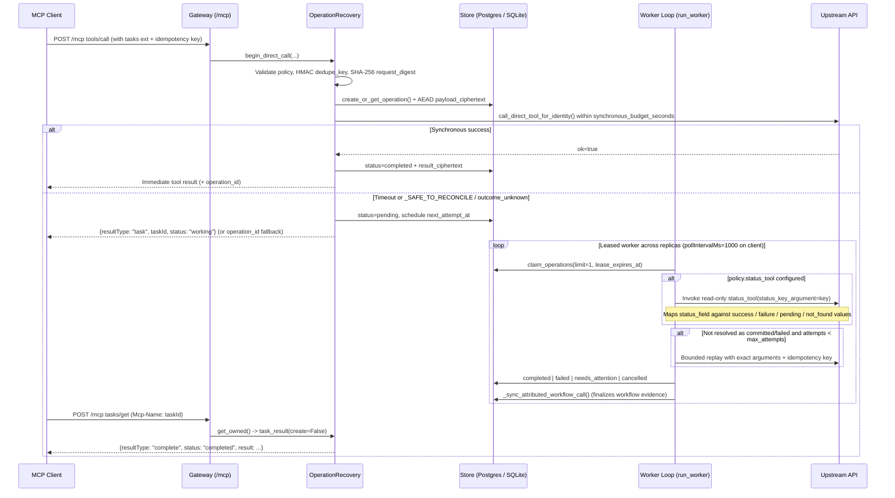

# MCP Tasks & Durable Write Recovery

MCPcodeaway implements sessionless **MCP Tasks** (`io.modelcontextprotocol/tasks`) in [`src/gateway/mcp_protocol.py`](../src/gateway/mcp_protocol.py), [`src/gateway/server.py`](../src/gateway/server.py), and [`OperationRecovery`](../src/gateway/recovery.py) to recover uncertain outcomes on **explicitly opted-in, idempotent direct mutating tool calls** without holding HTTP requests open or replaying unsafe writes.

## 1. Protocol Contract & Capability Advertisement

- **Protocol Version:** Sessionless HTTP (`MCP-Protocol-Version: 2026-07-28`, constant `MCP_PROTOCOL_VERSION`).
- **Capability Advertisement (`server/discover`):** Returns `capabilities.extensions["io.modelcontextprotocol/tasks"] = {}` alongside `instructions` and `tools`.
- **Client Opt-In (`tools/call`):** Clients advertise task support in `_meta["io.modelcontextprotocol/clientCapabilities"]["extensions"]["io.modelcontextprotocol/tasks"]`.
  - **Tasks-capable client:** When a write exceeds the synchronous budget or fails with a safe-to-reconcile error (`outcome_unknown` or `_SAFE_TO_RECONCILE`), `tools/call` returns:
    - `"resultType": "task"`, `"taskId": "<operation_id>"`, `"status": "working"`, `"statusMessage"`, `"createdAt"`, `"lastUpdatedAt"`, `"ttlMs"`, and `"pollIntervalMs": 1000`.
  - **Legacy client fallback (no Tasks capability):** Returns a standard tool payload containing `"operation_id"` and `"operation_status"` (`"pending"` / `"working"`), and polls via the built-in read-only `get_operation_status` tool (`{"operation_id": "..."}`).
- **Task Control Methods on `POST /mcp`:** Require the `io.modelcontextprotocol/tasks` extension header/metadata (missing capability returns JSON-RPC `-32021`) and `Mcp-Name: <taskId>` header parity (`taskId` mismatch returns HTTP error):
  - `tasks/get` — Ownership-verified (`tenant_id`, `requester_sub`, `client_id`) poll via `OperationRecovery.get_owned()`. Returns `"resultType": "complete"`, `"status": "working" | "cancelled" | "completed"`, and when `"completed"`, the decrypted final tool `"result"` inline. (`failed` and `needs_attention` internal states map to MCP `"status": "completed"` with `"isError": true` and a non-confirmed status message.)
  - `tasks/cancel` — Ownership-verified; marks `pending` or `working` operations with `cancel_requested` via `store.request_operation_cancel()` and returns `{}`.
  - `tasks/update` — Validated at the boundary (requires capability + `Mcp-Name` == `taskId` + ownership check) and returns `{}` (ack no-op).

## 2. Opt-In Policy & Safety Constraints

A direct mutating tool opts into durable recovery only when an administrator configures `ToolRecoveryPolicy` ([`src/gateway/config.py`](../src/gateway/config.py)) on the upstream:

| Constraint | Rule / Default | Source |
| :--- | :--- | :--- |
| **Idempotency key** | `idempotency_key_argument` must name a string schema property (`1..256` chars at call time); `upstream_key_retention_seconds >= max_recovery_age_seconds`. | [`ToolRecoveryPolicy`](../src/gateway/config.py) |
| **Platform ceilings** | `synchronous_budget_seconds <= 30.0`, `max_attempts <= 3`, `max_recovery_age_seconds <= 3600`, retention `60..86400`s (`task_worker_lease_seconds` default `300`, `task_worker_poll_interval_seconds` default `1.0`). | [`GatewaySettings`](../src/gateway/config.py) |
| **Encryption & dedupe** | Requires persistent `credential_encryption_key` (fails if ephemeral) and `>= 32`-char `GATEWAY_TASK_DEDUPE_SECRET`. Arguments/results use AEAD (`recovery-operation:<tenant_id>:<operation_id>`); dedupe uses HMAC-SHA256. | [`OperationRecovery`](../src/gateway/recovery.py) |
| **Payload immutability** | Reusing an idempotency key with different non-key arguments raises a digest mismatch (`-32602`). Reusing with identical arguments returns the stored terminal result or current task handle without a second write. | `begin_direct_call()` |
| **Disallowed paths** | Read tools, `delegated_token` upstreams, and Code Mode scripts (`execute_code`) cannot use task recovery. | `begin_direct_call()` |

## 3. End-to-End Task Recovery & Reconciliation Flow

### Safe Error Classes for Async Reconciliation (`_SAFE_TO_RECONCILE`)

Only `outcome_unknown: true` or the following error types schedule background reconciliation (all others transition immediately to terminal `failed`):
- `upstream_capacity_exceeded`
- `upstream_unhealthy`
- `upstream_unreachable`
- `upstream_timeout`
- `upstream_unavailable`

## 4. Operator Monitoring, Demo Lab & Protocol Audit Notes

- **Control Plane Inbox:** `GET /admin/operations` (`all | pending | working | completed | failed | needs_attention | cancelled`, tenant-scoped, redacted, no ciphertexts) and `GET /admin/operations/metrics` power **Operations Recovery** (`/dashboard/operations` in [`operations.vue`](../web/app/pages/operations.vue)). There is no manual replay button.
- **Workflow & Approval Integration:** When a recoverable direct write belongs to a tracked workflow call, terminal polling or worker finalization calls `_sync_attributed_workflow_call()`, and manager-approved actions record `"recovery_pending"` until completion ([`server.py`](../src/gateway/server.py)).
- **Demo Recovery Lab:** `POST /admin/demo/recovery/run` ([`examples/recovery_lab.py`](../examples/recovery_lab.py)) exercises lost-response task reconciliation, same-key replay deduplication, changed-payload rejection, and `get_operation_status` fallback against an isolated mock backend.
- **Implemented Protocol Scope vs. Full MCP Draft:** Because `POST /mcp` is stateless/sessionless, there is no server push (SSE/notifications). `tasks/get` and `tasks/cancel` are fully implemented (`tests/test_mcp_task_recovery.py`); `tasks/update` returns `{}` (no-op ack); `tasks/list` and `tasks/result` are omitted because `tasks/get` directly returns the encrypted result once completed.
