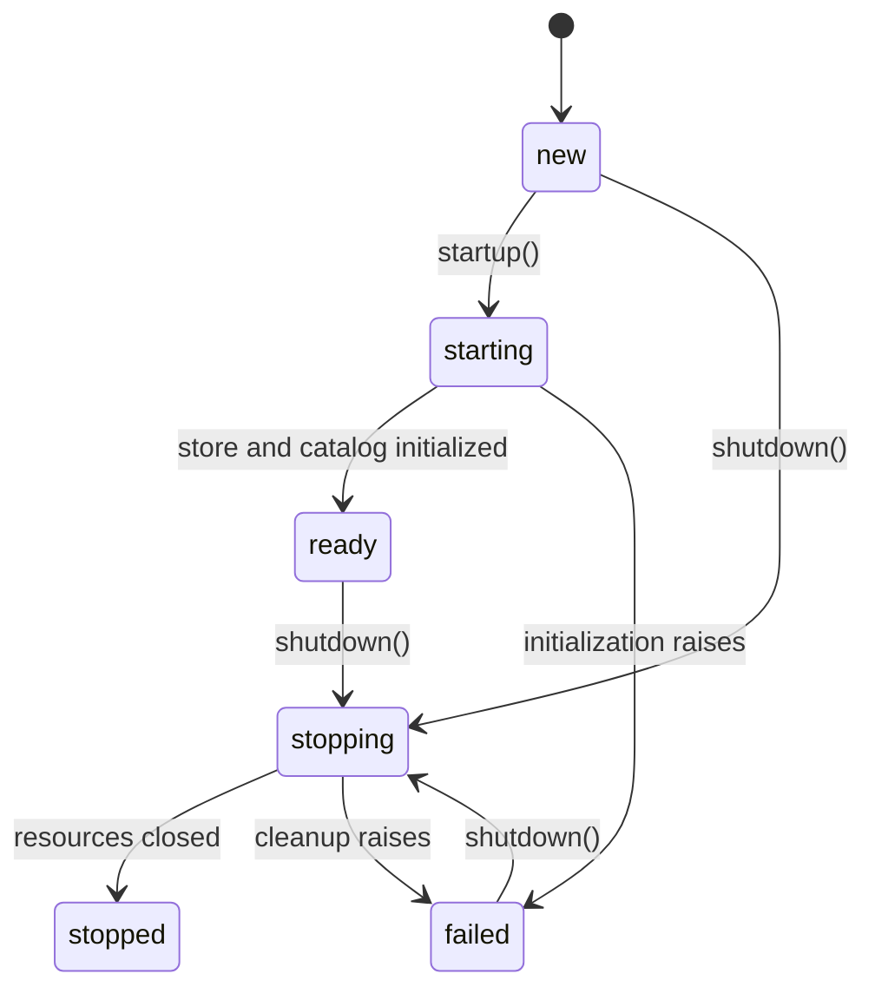

# Application State Machines

This file is the state map for the gateway and admin console. It names the
states that were previously inferred from booleans, nullable values, task
handles, query parameters, and combinations of page flags. It is a navigation
aid for maintainers and agents: the owning module remains the source of truth
for each transition.

For the end-to-end user, agent, operator, and runtime journeys, see the
[Gateway Flow Map](gateway-flow-map.md). This file remains the detailed
reference for state transitions and state ownership.

## Gateway process lifecycle

Implemented as `GatewayLifecycleState` in `gateway.server`.

## Direct tool approval

The durable approval lifecycle is owned by `AuditStore` and enforced in
`gateway.server`. Requester confirmation is separate from the manager decision.

```mermaid
stateDiagram-v2
    [*] --> requester_confirmation
    requester_confirmation --> pending: requester accepts; persist exact action digest
    requester_confirmation --> declined: requester declines
    pending --> approved: eligible group member approves
    pending --> denied: eligible group member denies
    pending --> expired: TTL elapsed
    pending --> invalidated: policy version changes
    approved --> executing: requester retries exact call; atomic claim
    approved --> expired: TTL elapsed
    executing --> completed: upstream returns
    executing --> execution_failed: dispatch fails
```

Only `approved` may transition to `executing`, through a compare-and-set claim.
The requester must be re-authenticated and re-authorized on retry. The exact
argument digest, tenant, requester, tool, and policy version must match the
stored record. One eligible group member is sufficient in v1, and requesters
cannot approve their own action. Pending work is not dispatched; the original
MCP request does not remain open while a person decides.

`is_ready()` is true only in `ready`, then still checks required shared
dependencies. Calling `startup()` while already ready is idempotent. Calling
`shutdown()` after `stopped` is idempotent. Invalid transitions raise with the
source and destination states in the message.

## Request, identity, and authorization flows

| Flow | States and transitions | Owning code / persisted state |
| --- | --- | --- |
| MCP request | received → authenticated → authorized → dispatched → filtered/redacted → recorded/responded; any guard may end in a protocol error | `server.mcp_endpoint`, `dispatcher.HostDispatcher`, `auth.PolicyEvaluator`; request lifecycle is a sequence of gates rather than a stored session |
| Requester confirmation | unprotected → confirmation required → signed continuation issued → nonce consumed once → dispatched; decline, mismatch, stale policy, replay, or unsupported elicitation terminates without the protected dispatch | `server._approval_request_state`, `_verify_approval_request_state`, `_input_required_confirmation`; one-time nonce in `state.AuditStore` |
| Admin authentication | unauthenticated → OIDC/dev token validation → session established with role → expired/logout/denied | `admin_auth.AdminSessionManager`, `admin_auth` routes, `useAdminApi`; browser session and optional bearer token |
| Per-user OAuth link | ticket issued → authorize/PKCE redirect → callback verified → token exchanged → encrypted credential stored → linked; failures leave the credential unlinked | `user_connect` routes, `CredentialVault`; OAuth state/PKCE and signed connect ticket are transient, credential is durable |
| Per-user API key link | ticket/form opened → secret submitted → encrypted credential stored → linked; invalid ticket or validation error ends without storage | `user_connect.submit_user_secret_form`, `CredentialVault` |

MCP calls are intentionally sessionless. A client must pass resource identifiers
as explicit arguments; the gateway does not keep an MCP conversation session.
Approval continuation is deliberately a short-lived, single-use request token,
not a durable approval queue.

Durable write recovery is separate from MCP conversation state. It is enabled
per direct mutating tool only when the upstream API honors the configured
idempotency key. The first attempt uses a short synchronous budget; an uncertain
outcome is persisted and returned as an MCP task only when that request
advertises the Tasks extension. Other clients receive an operation ID and can
poll the built-in `get_operation_status` tool. Recovery replays the same stored
arguments and key, never generated Code Mode. Each poll reauthorizes tenant,
subject, and client. Recovery is bounded by the configured attempt count and age;
unresolved writes become `needs_attention` for operator review. There is no
manual replay control or push notification in this MVP.

## Gateway operations and adaptive behavior

| Flow | States and transitions | Owning code / representation |
| --- | --- | --- |
| Upstream discovery at startup | configured → discovered, skipped (preloaded or no discovery identity), or warning; warnings may retry in the background | `GatewayRuntime.refresh_catalog`, `_retry_failed_startup_upstreams`; catalog plus `startup_warnings` |
| Configured upstream probe and circuit | unknown → healthy/degraded → unhealthy (open); consecutive successful probes return it to healthy (closed); disabled probes do not gate calls | `config.UpstreamHealthCheckConfig`, `monitoring.UpstreamHealthMonitor`; per-process status snapshots and probe task |
| Downstream tool failure | success, or typed failure with safe message; transient read transport errors retry once; writes never retry and may mark outcome unknown; open probe circuit pauses calls until recovery threshold | `errors.classify_upstream_error`, `dispatcher.HostDispatcher.invoke_tool`; `SubcallRecord.error_type`, `retry_attempts`, and `outcome_unknown` |
| Durable write recovery | working → completed; or working → pending → leased working → completed / failed / cancelled / needs_attention | `recovery.OperationRecovery`; encrypted operation row in `AuditStore`, caller-scoped idempotency fingerprint, attempt/deadline limits, and a database lease shared by replicas |
| Demo traffic | stopped ↔ running; start creates a task, stop cancels and joins it; tier selection changes the schedule | `demo_traffic.DemoTrafficRunner`; task presence currently represents running |
| Adaptive evidence | imported → rejected or accepted; accepted rows qualify a model/workload after five matched pairs; qualified rows still need the joint quality floor and regression checks to recommend a mode | `adaptive_execution.summarize_pairs`; evidence rows and derived `qualification` / `recommended_mode` |
| Adaptive rollout | Observe → Active → Observe; Active affects eligible Auto requests only, while Observe reports recommendations without applying them | `GatewaySettings`, `server` adaptive-execution routes and request selection |
| A/B experiment | disabled → enabled assignment per request; eligible read-only evidence may produce a promotion recommendation; configuration controls automatic switching | `config.AbExperimentConfig`, `ab_testing`; persisted upstream configuration and audit evidence |
| Retention scheduler | off/hourly/daily policy → periodic check → skip or prune; cancellation ends the scheduler | `GatewayRuntime._retention_loop`; saved retention policy plus task handle |

## Admin-console workflows

| Flow | States and transitions | Owning code / representation |
| --- | --- | --- |
| Onboarding wizard | Connect (inspect schema) → Policy (configure access, modes, optional per-write recovery, and optional unauthenticated health URL) → Test & Publish (test/evaluate/register); only a verified schema unlocks progression; inspect failure retains the draft and exposes an error | `web/app/pages/onboarding.vue`; `OnboardingStep` and `SchemaInspectionState` name the navigation and inspection states, with guarded transitions |
| Operations recovery view | loading → tenant-scoped operation list, empty state, or retryable error; status filter refreshes the list | `web/app/pages/operations.vue`; read-only `/admin/operations` API, admin/viewer role gate |
| Upstream operations view | loading → historical call summary plus optional live probe status and error-category breakdown; unavailable summary remains an actionable error | `web/app/pages/upstreams.vue`; `/admin/adaptive-execution/tool-health` |
| Live telemetry | idle → connecting → live → reconnecting → connecting; explicit disconnect or an unbuildable URL ends retries | `web/app/composables/useUiAgent.ts`; `TelemetryConnectionState` is the exposed state, while the socket and timer own transport details |
| Admin API load/save actions | idle → loading/saving → success or error; each page owns its data and error message | `web/app/pages/*.vue`, `web/app/composables/useAdminApi.ts`; page-local busy flags and result/error refs |
| Agent confirmation prompt | no pending request → waiting for operator decision → allowed/denied; abort resolves as denied and clears the pending prompt | `web/app/composables/useUiAgent.ts`; pending request with a resolver |
| Demo controls | server-reported stopped/running plus request-in-progress; tier update has requested and persisted values | `web/app/composables/useUiAgent.ts`; API `DemoTrafficStatus`, local `busy` flag |

Page-local Admin API load/save flows still use booleans and result/error refs;
their state ownership remains page-specific. Keep the transitions above in sync
when changing those flows and preserve distinct loading, empty, success, and
failure feedback.

## State ownership rules

- Persist business state (credentials, approval replay nonces, configuration,
  audit evidence, and opt-in recovery operations) in its configured durable
  store. Do not treat a process-local task, browser ref, or cache entry as
  durable state.
- Derive status from one authoritative owner where possible. In particular,
  runtime readiness comes from `GatewayLifecycleState`; dependency health is an
  additional readiness condition, not a second lifecycle flag.
- Keep terminal and degraded outcomes distinct from success. A warning, retry,
  unsupported capability, denied confirmation, or failed optional telemetry
  connection must not be represented as a successful transition.
- Preserve API contracts when adding status fields. Machine state names are
  internal unless explicitly added to a documented response schema.
